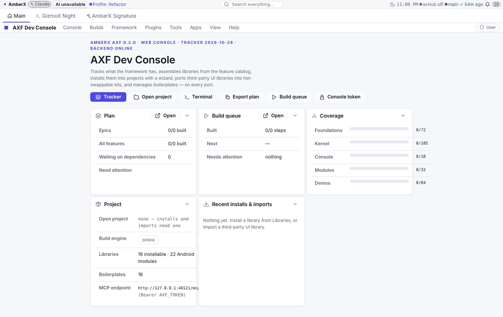
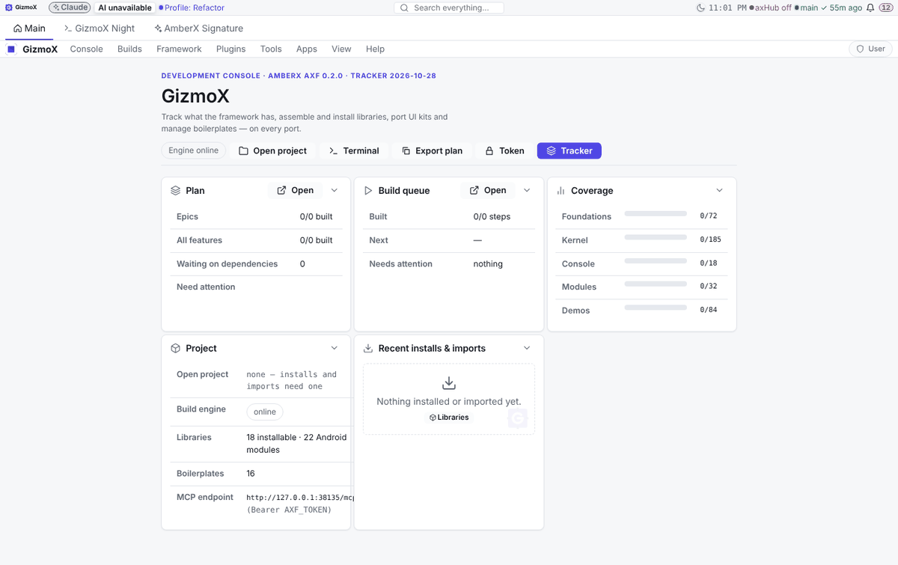
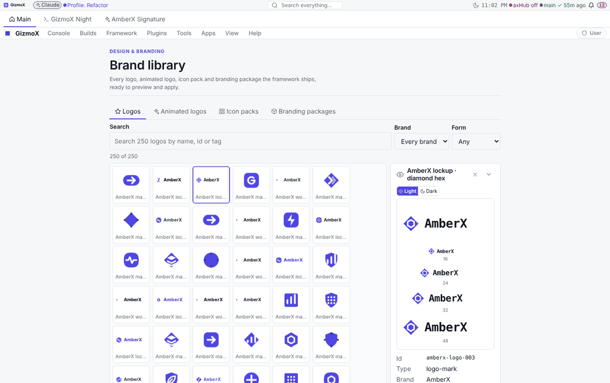
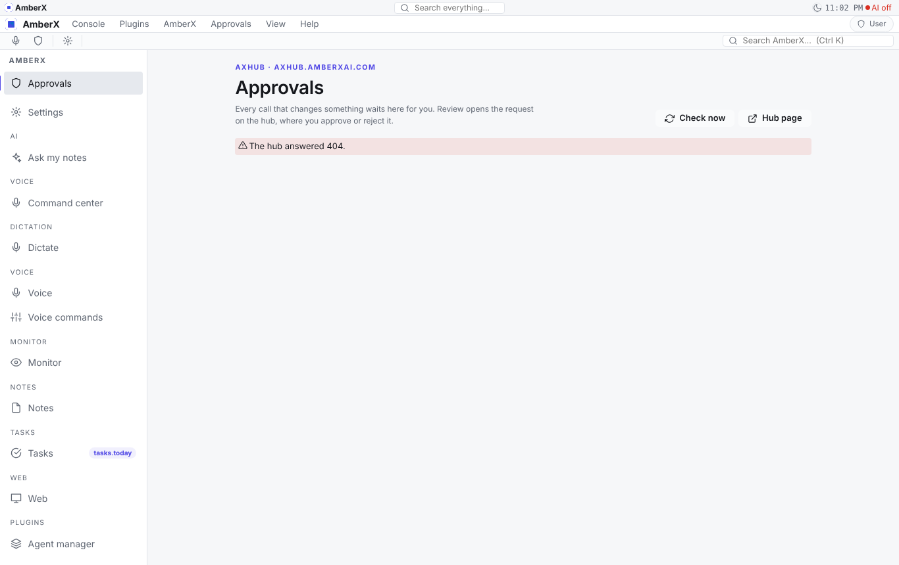
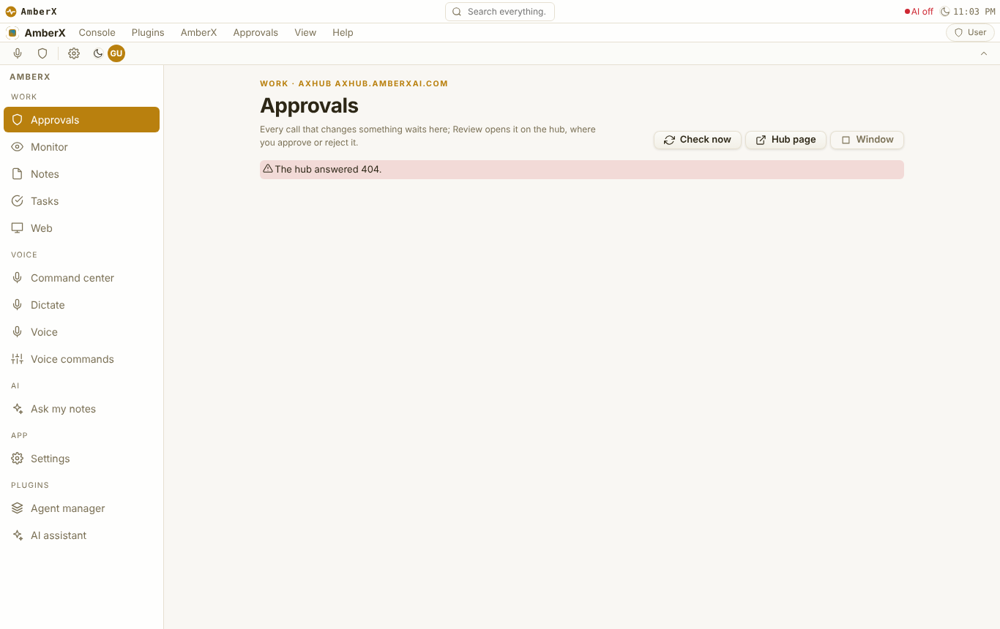
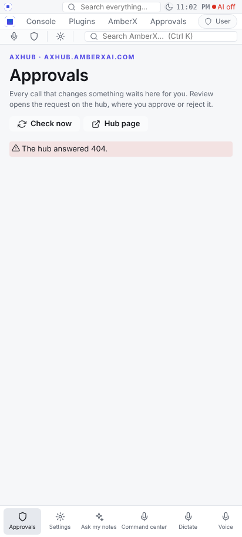
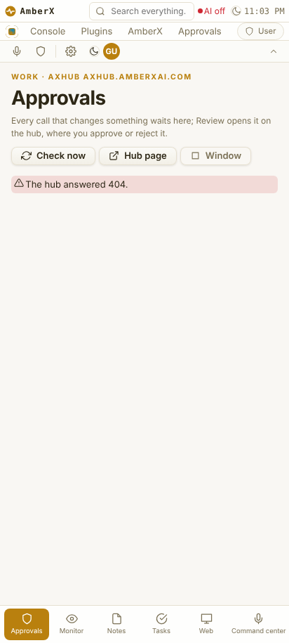

# enterprise-branding, phase 3 (refactor-all s28–s40) — differences report

**Model:** Opus · **Branch:** `refactor-all/branding` (base `ef581b80` = main + Terminal plugin + Fable window engine and settings levels) · **Date:** Oct 28 2026
**Scope (Brett, Oct 27):** the console (GizmoX), the AmberX app, the plugins installed and switched on (all 35; every one is `enabledByDefault` and no switch is off), every banner plugin. Web only; Android twins deferred (`framework/spec/PORTING.md`). Patches untouched (paused).

## Added
- **Brand library console plugin** (`apps/console-web/plugins/brand-library`, builtWith opus): nav → Plugins → Brand library and View → Look → Brand library…; tabs Logos · Animated logos · Icon packs · Branding packages; search, brand + form / motion / style filters; a virtualised tile wall (only the visible rows are drawn — lib-datagrid is a table, so the wall is windowed with the pure `gridWindow`); preview pane (light / dark surface, 16–96 px, animation replay); **Set as brand** (branding package) / **Apply as mark · wordmark · lockup · animated mark · icon pack** (a derived `bl-<hash>` branding package built from the active brand); **Copy id**; the last applied brand is re-applied on load (axHub's look document wins when it drives the look). Server: `GET /index`, `/assets/<type>`, `/closure/<type>/<id>`, `GET/PUT /config` (library read-only, never bundled). Settings tab (opens on, brand filter, tile size, names, motion, applied brand + Reset), lifecycle panel, menu entries. Tests: `test.py` 25, `test.mts` 20.
- **AmberX app:** own design packages `amberx-app-day` / `amberx-app-night` (geometric style, saffron / carbon-amber colours, amber behaviour, Amber Signature control set, AmberX banner/toolbar/nav), branding `amberx-app` (AmberX Signature marks placed by DESIGN-LANGUAGE §10), banner `amberx-branded` (32 px, lockup, one search), theme switch `amberx-day-night`; any page opens in a floating window on the window engine (`amberx.window:<view>`, nav right-click → Open in a window, Approvals → Window).
- **Console:** shared `EmptyState` (icon, one sentence, one action, brand watermark) and `LoadingSkeleton` in `src/emptyState.tsx`; tab title = page · brand.
- **Framework:** nav sections with the same eyebrow merge (`mergeNavSections`), counter badges on nav items (`NavBadge`), menu bar reads the branding name + `app-menu` mark, one **plugin banner card** in `axf.css` (`.fx-banner-frame` first child; plugins set only `--axf-banner-tone`), `defaults.json` names design package `fresh`.
- **Checker:** `framework/cli/check-plugin-pages.mjs` (DESIGN-LANGUAGE §12: page head eyebrow — never the bare word "Plugin" — + h1 + one sentence; no spinners; every plugin page has a head), wired into `android.yml`.

## Changed
- **GizmoX:** the console's manifest defaults to branding `gizmox` + design package `fresh`; menu bar, Home title and the browser tab read the brand name ("GizmoX"); `index.html` title. Code ids and URLs unchanged.
- **Plugins (three thirds):** 1/3 agent-manager, ai-assistant, ai-keys, alerts-bell, basic-filter, build-orchestrator, build-profiles, changes-grid, claude-badge, console-terminal · 2/3 container-access, context-menu-designer, fable-rebuilds, feature-assist, hub-sync, main-build-status, mcp-client, molly-guide, plugin-manager · 3/3 plugin-switches, plugin-update, plugins-menu, project-wizard, session-checkin, snapshot-manager, theme-manager, todo-manager, voice-notes. Section eyebrows + one-sentence page heads, `Loading…` → skeletons, empty lists → `EmptyState`. Plugin Manager's four layouts keep their own heads (`design-ok`).
- **Banner plugins:** activity, approvals, build manager, codebase changes, push, systems check / keys needed / What's new, Claude handoff — their box styling moved to the shared card; each sets only its tone; rows shrink text first and keep actions whole (snap / never-overlap rule). Codebase changes and Claude handoff pages got proper heads. The approvals banner's markup is untouched (one CSS rule changed).
- **AmberX:** nav grouped Work · Voice · AI · App (plugin pages filed by eyebrow); toolbar ≤ 12 items, no duplicate search; Approvals: review chip, skeleton cards, pop-out; icons that exist in the framework set (`close`/`power`/`arrow-*` fell back to a box).
- **Re-bakes:** amberx-droid, console-web, axhub-web, walkthrough-studio, demo (forced: their "edited" files were older framework copies, no local edits; baked libs re-copied too). Demo gained the slots the current framework requires. Every web app manifest names a design package and branding. Patches-web skipped.

## Removed
- Nothing user-visible. AmberX's copies of the Signature design packages (`amberx-signature-*`, toolbar `amberx-signature`, nav `amber-signature`, layout `signature-dock`) were not kept: they name console pages AmberX doesn't have.

## Tests before → after
- console-web typecheck + build ✓ → ✓; theme-swap ✓ → ✓; menu-reach 228 ✓; interface-scope 7 ✓.
- amberx-droid `test.mjs` 1629/1630 (banner default) → 1863/1863; build ✓.
- check-theme ✓, check-controls ✓, check-plugin-pages (new) ✓ 26 heads in 44 plugins; plugin-lifecycle check clean for every touched plugin.
- check-brand 205, check-design-package 729, check-style-packages 744, check-design-language 427, check-interface 63, check-toolbars 590, check-appearance 100, check-app-menu 123, check-settings-ui 43, check-widgets 241 — all green.
- Plugin self-tests green except three that fail on the base too (profile data): fable-rebuilds, feature-assist, claude-handoff `test.py`. `tracker.mjs --check` fails on the base as well (391 items without status in the Refactor profile).

## Shots
`enterprise-branding-3/shots/{before,after}/` — console home (phone + desktop), theme manager, codebase changes, settings; after only: brand library (phone + desktop + preview); AmberX desktop + phone (+ page window after). Taken with a local stand-in axHub (404 = nothing saved) because the sandbox can't reach axhub.amberxai.com.

| | before | after |
|---|---|---|
| Console home |  |  |
| Brand library | — |  |
| AmberX |  |  |
| AmberX phone |  |  |

## Known gaps / merge notes
- `refactor-all/veto` (approvals banner held rows) and `refactor-all/plugin-theme` (plugin theme override) are not in this base: expect conflicts in `approvals-banner/web/approvals-banner.css` (root rule), `framework/ui/axf.css` (banner section), the re-baked `src/axf` copies and `axf.lock.json` files (re-bake again after merging), and plugin page heads / settings panels. Keep the held-row feature.
- Android twins deferred (PORTING.md). The Brand library is console-only (not in AmberX).
