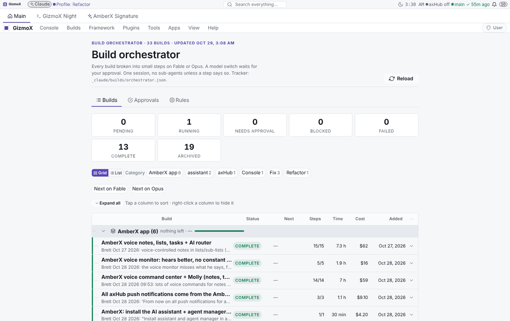
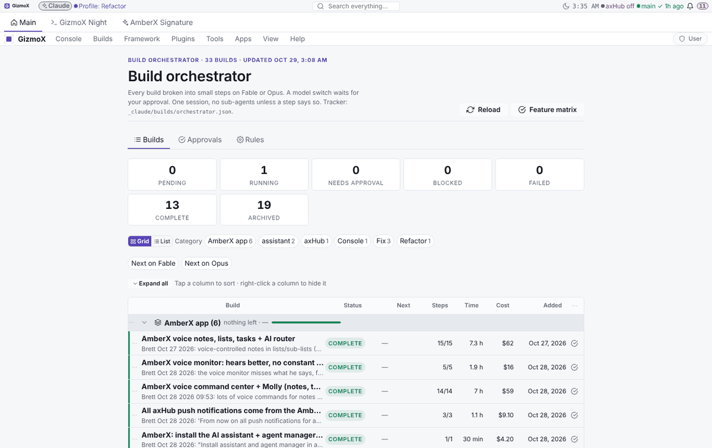
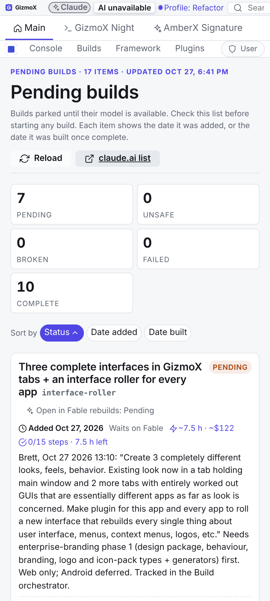
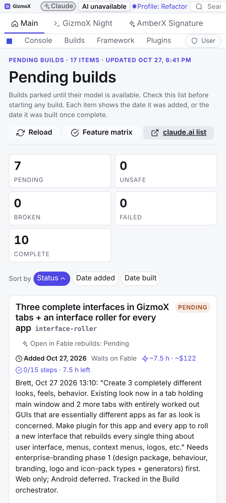
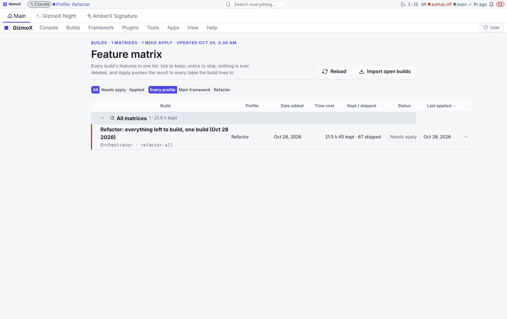
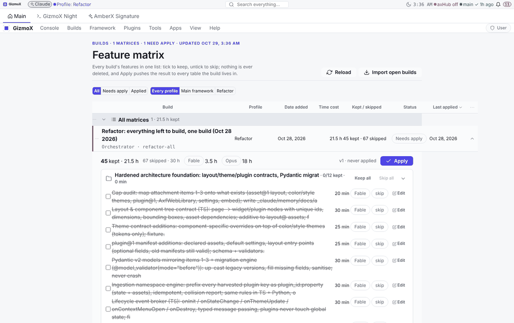
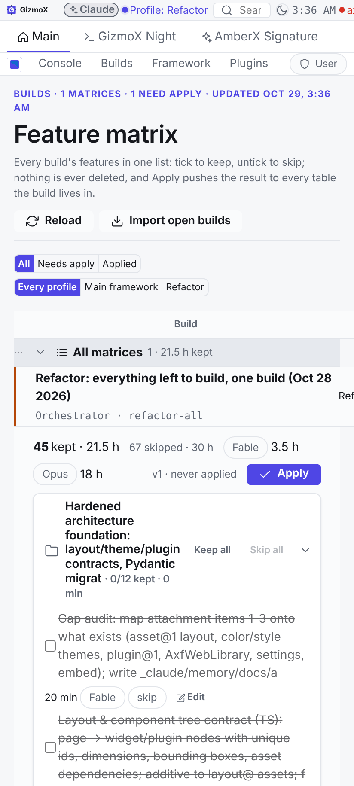
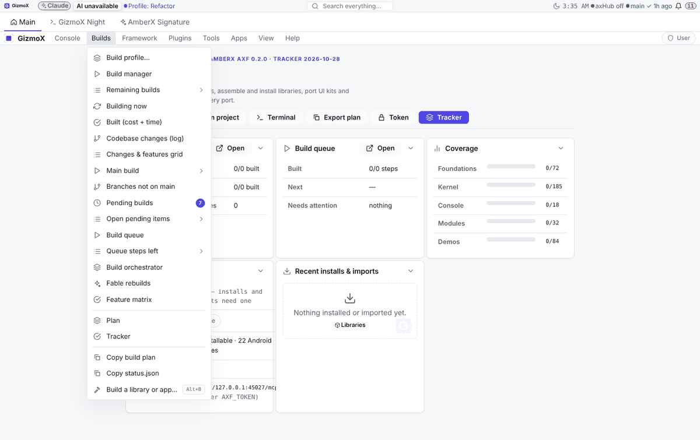

# Feature matrix plugin (refactor-all s62–s67, Opus, Oct 29 2026) <!-- axf-plugin:feature-matrix -->

New console plugin `apps/console-web/plugins/feature-matrix` on the feature-matrix@1 contract + Apply engine (Fable phase). Contract and plugin details: [feature-matrix.md](../feature-matrix.md). <!-- axf-plugin:feature-matrix -->

- Removed: nothing. Kept: the contract, the Apply engine and its fixture (unchanged; `check-feature-matrix.mjs` 30/30). <!-- axf-plugin:feature-matrix -->
- Added: the plugin (page, grid, matrix view, CLI/store, server, lifecycle, `test.mjs` 17 + `test.py` 16); lib-datagrid row hooks (grid-hook@1, `datasets.ts` + `DataGrid rowRef` + `RowHookButtons`), wired into the orchestrator, Pending builds, Build queue, Plan, Build manager and Changes grids; slot `builds.toolbar` on the Builds pages; app menu Builds ▸ Feature matrix. <!-- axf-plugin:feature-matrix -->
- Compatibility: grids without `rowRef` draw exactly as before; the tail column grows only when a row hook is registered. Re-baked console, axhub-web, amberx-droid, walkthrough-studio (Patches skipped). The draft `matrices.json` (feature-matrix@0) is read as @1 and rewritten as @1 on the first save or Import. <!-- axf-plugin:feature-matrix -->
- Gaps: windows-terminal scope list (artifact db only) not imported; Android twin of row hooks deferred (PORTING.md). <!-- axf-plugin:feature-matrix -->

| Before | After | <!-- axf-plugin:feature-matrix -->
| --- | --- | <!-- axf-plugin:feature-matrix -->
|  |  | <!-- axf-plugin:feature-matrix -->
|  |  | <!-- axf-plugin:feature-matrix -->
| — |     | <!-- axf-plugin:feature-matrix -->
