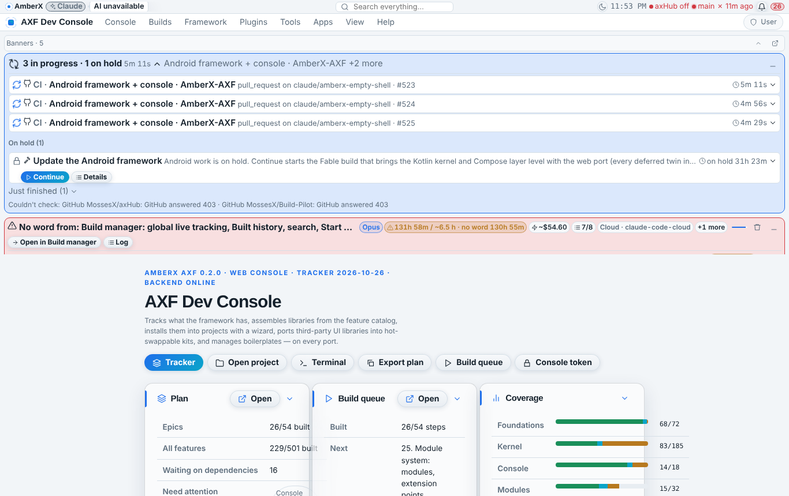
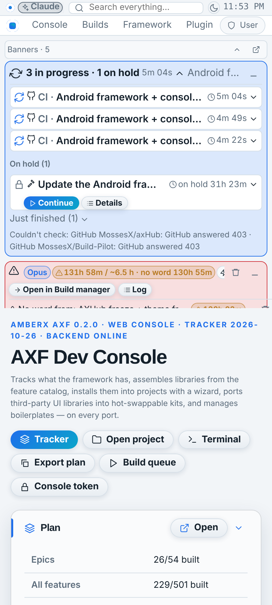
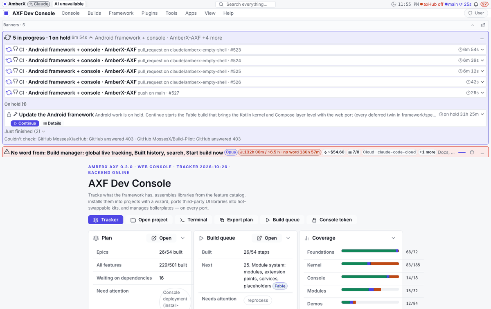
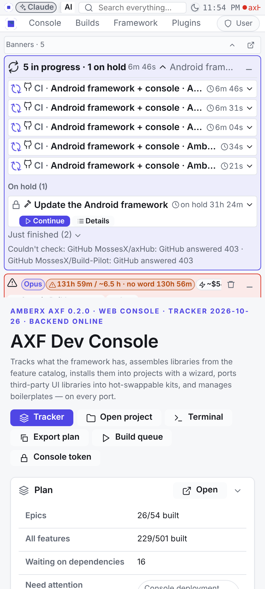
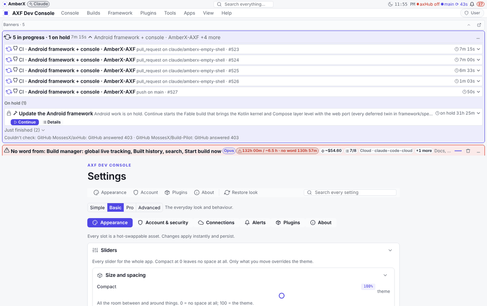

# Fresh look: new default style theme + `fresh` appearance package (Oct 27 2026, Opus)

Asked (Brett, Oct 26 2026 23:51): "Rebuild the default style theme, the UI looks like shit, but save the new look as a
full appearance package asset named fresh." Cards: Opus; a **new `fresh` theme made the default** (Glass Orbit stays
selectable); built in this session.

## What replaced what

| Slot | Before (default) | After (default) |
|---|---|---|
| style-theme | `glass-orbit` (Manrope/Sora 15 px, radii 10/16/24, spacious, blur 22, deep shadows, glass 0.6) | **`fresh`** (Inter 14 px, radii 6/10/14, comfortable, blur 10, low two-layer shadows, glass 0.86, motion 160 ms, headings 600, tracking −0.011) |
| color-theme | `arctic-daylight` | **`fresh-light`** (neutral greys, indigo `#4f46e5`, quieter status colours) |
| theme-switch | `day-night` (arctic-daylight ↔ amber-ember) | **`fresh-day-night`** (fresh-light ↔ **`fresh-dark`**) |
| button (console) | `pill-gradient` | `rounded-solid` |
| container (console) | `frosted-glass` | `soft-card` |
| slider (console) | `precision-bar` | `classic-round` |

Every other slot is unchanged; spacing stays Super tight.

## Added
- Assets in `framework/assets` and the web apps' `src/assets` (console-web, axhub-web, patches-web, amberx-droid,
  walkthrough-studio): `style-theme/fresh`, `color-theme/fresh-light`, `color-theme/fresh-dark`,
  `theme-switch/fresh-day-night`.
- **Appearance package `fresh`** (appearance-package@1) in the framework and in each of those apps, built from that
  app's own defaults (its layout, menus, banner, hidden chrome), spacing `tight`. Pick it in Settings → Appearance →
  Look from axHub → Appearance package.

## Kept
- `glass-orbit`, `arctic-daylight`, `day-night` and the `amberx` package (the old look, one pick away).
- `apps/demo` (untouched axf init output) and the Android apps' manifests (Android hold).

## Changed
- Defaults: `framework/defaults.json` and the five web apps' `axf.manifest.json`.
- Fixtures regenerated (additions only): appearance, components, roll, spacing, theme, widgets.

## Compatibility
- Developer apps (console, axHub web, Patches web, AmberX, Walkthrough) take their look from axHub's appearance
  document; a saved pick there still wins over the new defaults until the `fresh` package is applied (or the hub
  document is updated).
- No engine, contract or API changes; Kotlin needs nothing new (assets only). No Fable rebuild: not engine work.

## Tests
validate --framework 96 assets, console 98, axhub-web 88, amberx-droid 88, walkthrough 102 (patches-web keeps its
older "missing src/views" error); check-appearance 80, check-appearance-package 24, check-widgets 241,
check-customize 131, check-meters 39, check-settings-ui 31, check-looktokens 195, check-theme 475 files; console build.

## Screenshots (console, light, scratch data, hub off)
Before:  
After:  

(After shots were taken just before the light theme's third surface went from `#eef0f3` to `#e6e9ee` so slider
tracks and secondary buttons show.)
