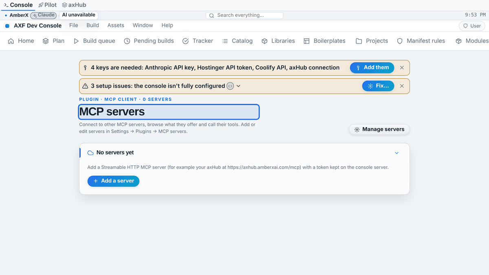
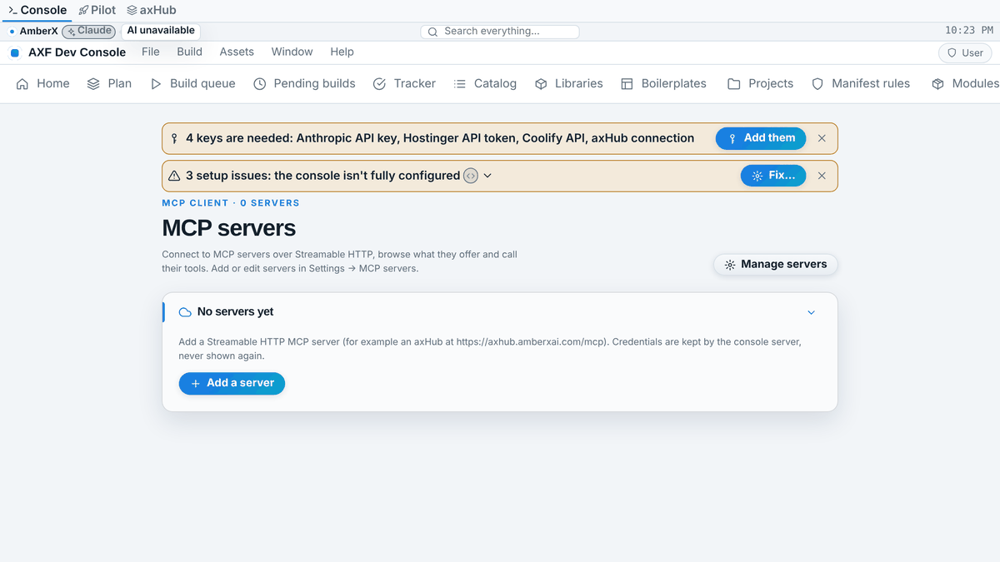
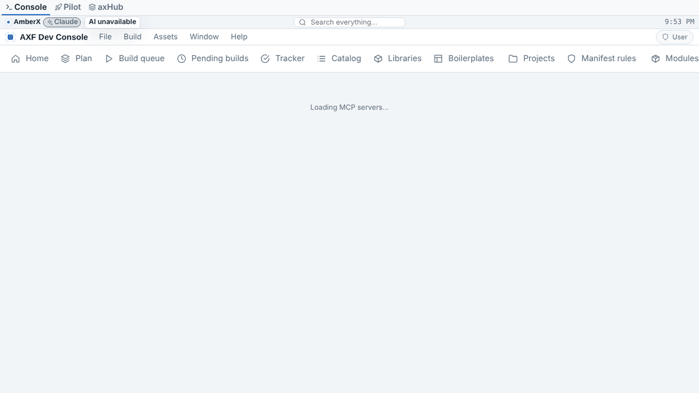
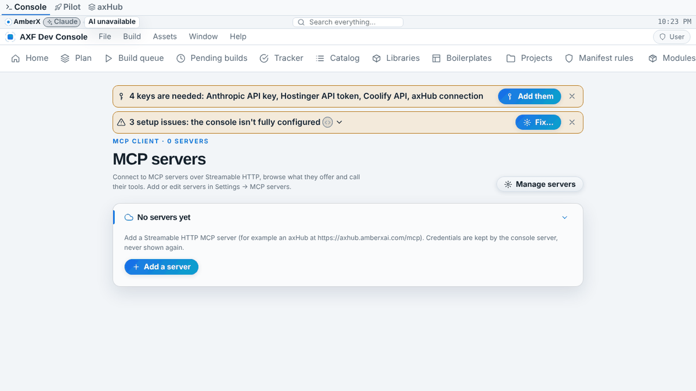
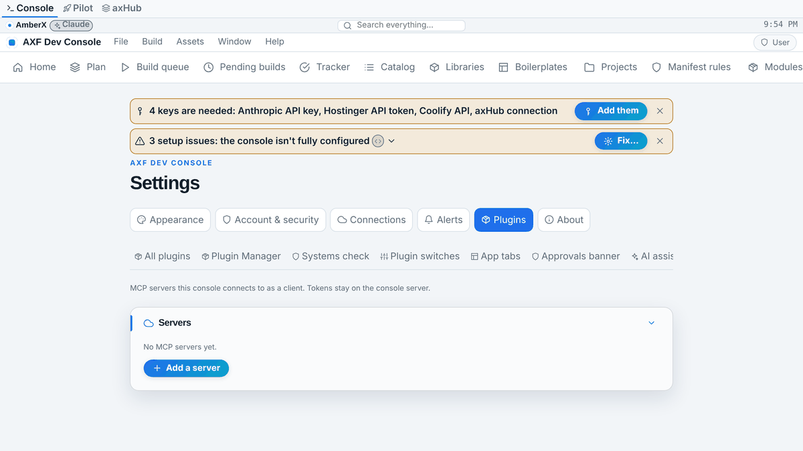
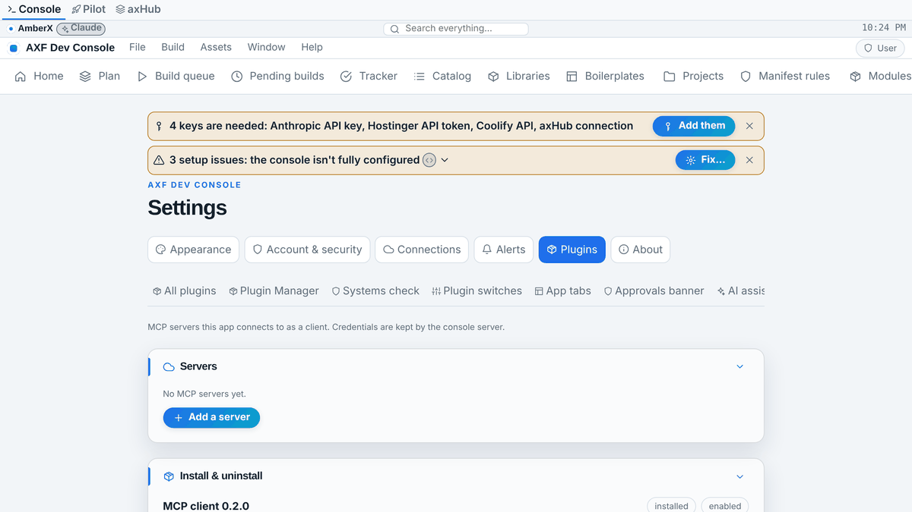
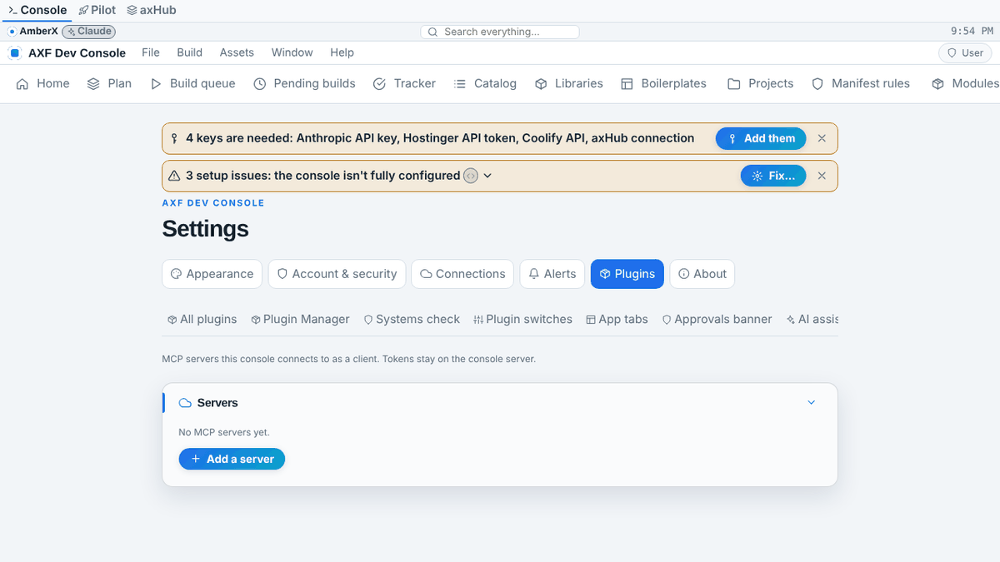
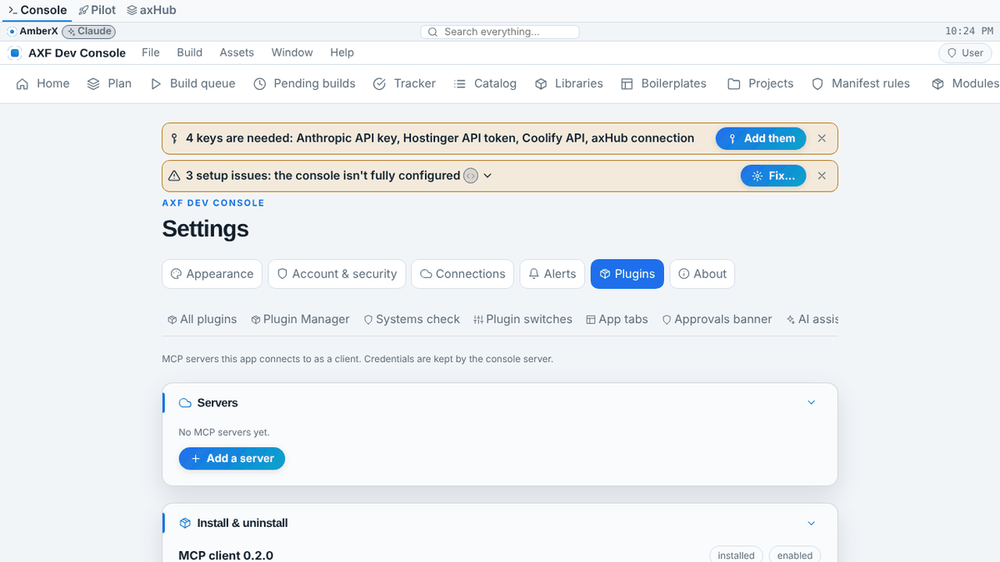
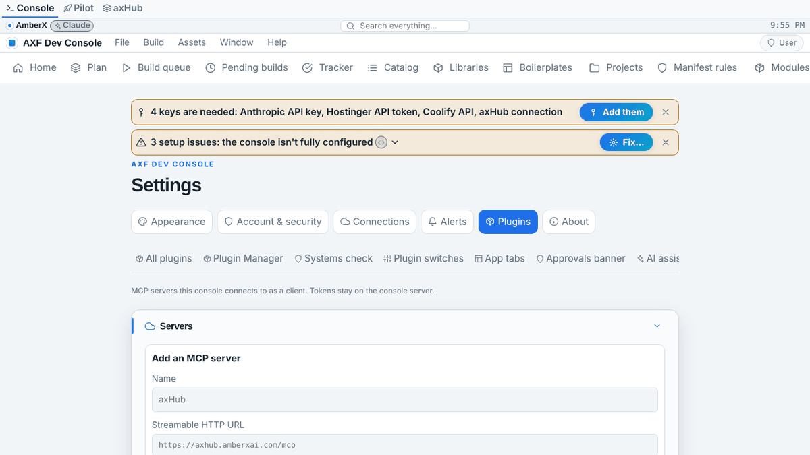

# lib-mcp — Fable rebuild (Oct 20 2026)

Branch `fable/lib-mcp`. Pending item `lib-mcp`, plan epic `x.lib.mcp`. Replaces: the Opus console plugin
`apps/console-web/plugins/mcp-client` (Oct 18 2026; its own protocol code on the `mcp` Python SDK + a web part). <!-- axf-plugin:mcp-client -->

## Summary

The MCP client is now a **framework library on all three ports** instead of console-only code: one pure engine
(`core/engines/mcp.ts` = Kotlin `kernel/mcp/McpEngine.kt` = Python `axf_libs/mcp/engine.py`, pinned by a shared
fixture `spec/fixtures/mcp-client.json`), one client contract (`McpClient` over a host-implemented transport + <!-- axf-plugin:mcp-client -->
credential provider, so UI code never holds a token), server registries that keep tokens out of records (secure store
on Android, server file on the console, a secret store in browser-only apps), the **outbound call gate** from
INTEROP.md (role must hold `mcp.call` / `mcp.call.write` / `mcp.call.destructive`; destructive tools are confirmed by a
person first), library views on web (MCP servers + Settings → MCP servers) and Compose screens on Android, and the
kernel's first `axf.remote` **RemoteServices** provider. The console plugin was rebuilt in place on the library:
same routes, data file, env vars and behaviour, plus a `prompt` route, plugin-lifecycle@1 and a 24-check self-test.
Headline improvements: cross-port parity (210 fixture/behaviour checks replayed on TS and Python, Kotlin in CI), no
third-party MCP SDK in the request path (stdlib Python, fetch, OkHttp), real cancellation/timeouts/session recovery,
redirects refused (a token never follows one), permission-gated tool calls instead of a bare `confirm()`.

## Removed

- The plugin's own protocol code (`_with_client` on the `mcp` SDK `Client`/`streamable_http_client`, `_dump`,
  `_describe`, `_headers`) — replaced by `axf_libs.mcp.McpClient` + `FileRegistry`. The `mcp` pip package is still
  required by the console (its own MCP *server* `/mcp` uses it); the plugin no longer imports it.
- The plugin's own React views, store and CSS (`web/index.tsx` 390 lines, `web/mcp-client.css`) — replaced by the <!-- axf-plugin:mcp-client -->
  library's views (`framework/libs/mcp/index.tsx`, `mcp.css`, prefix `axf-mcp`), configured by a 60-line host file.
- `globalThis.confirm()` for destructive tools — replaced by an in-page confirm card gated by permission.

## Kept

- Plugin id `ai.amberx.axf.console.mcp-client`, folder `mcp-client`, nav under Plugins, settings sub-tab id `mcp`, <!-- axf-plugin:mcp-client -->
  panel `mcp.servers`, view title "MCP servers".
- Routes (console token every method, 404 when disabled, never on the console MCP): `GET/POST /api/plugins/mcp-client/servers`, <!-- axf-plugin:mcp-client -->
  `DELETE /servers/{id}`, `POST /servers/{id}/connect|call|read`, `GET /log`; request/response shapes (server records
  with `auth`, `envPresent`, `lastCheck`; `connect` → `server`, `instructions`, `protocol`, `tools`, `resources`,
  `prompts`, `resourcesError`/`promptsError`; `call` → `isError`, `content`, `structured`; `read` → `contents`).
- Data format `mcp-servers@1`, `AXF_MCP_SERVERS` and `AXF_MCP_TIMEOUT` (30 s), 0600 file, atomic replace.
- Auth model: `tokenEnv` (preferred) or a stored token typed once; a token never returns to the browser; an unset
  env var → 400; remote failures → 502 with the server's name; the 200-row in-memory call log.
- Server-only mode: the console never launches local commands; Streamable HTTP (http/https) only.
- Every security guard of the Opus build (URL scheme check, id/env-name patterns, length caps, a new server never
  replaces another, text-only rendering of remote content).

## Changed

- Server part now imports `framework/python/axf_libs/mcp` (stdlib `urllib`, synchronous, run in a thread pool);
  sessions are still one-per-operation (connect → close) so the routes stay stateless.
- Data file default moved from `.axf-console/mcp-servers.json` to `.axf-console/plugins/mcp-client/mcp-servers.json` <!-- axf-plugin:mcp-client -->
  (plugin-lifecycle@1 `dataDir`); the old path is still read while the new file doesn't exist, and `install.mjs`
  moves it once.
- `connect` adds `sessionId`, `capabilities`, `resourceTemplates`.
- The web part is a host adapter: `createMcpLibrary({ host, envAuth: true, navLabel: 'Plugins', permissions: … })`.
  In the console all four MCP permissions map to `dev.tools` (held by the standard `user` role and hub admins, not by
  the wall's `user`/`themes` roles) — the library's own names (`mcp.*`) are the defaults for apps.
- Destructive tools: a confirm card in the page (library) instead of `window.confirm`; write tools need the write
  permission; denied tools are greyed with the reason.
- Version `0.1.0` → `0.2.0`.

## Added

- `framework/core/engines/mcp.ts` — pure engine: `rpcRequest/rpcNotification/parseMessage(s)`, `SseParser/parseSse`,
  `mcpHeaders`, `initializeParams`, `negotiate`, `offers`, `classifyResponse`, `pageParams/mergePages`,
  `errorFromRpc/Http/Transport`, `toolEffect`, `callGate` (+ `McpPermissionSet`), `contentText`, `serverIdFor`,
  `validateServerInput`, `argumentSkeleton`; constants `MCP_PROTOCOL_VERSION` 2025-06-18, `MCP_SUPPORTED_VERSIONS`,
  header names, `MCP_PERMISSIONS`, `MCP_WIRE` codes.
- `framework/libs/mcp/` (web, `ai.amberx.axf.mcp`, library.json): `client.ts` (`McpClient`, `McpTransport`,
  `McpCredentialProvider`, `fetchTransport`, `McpError`), `host.ts` (`McpHost`, `McpServerRegistry`, `McpSession`,
  `McpCallLog`, `localHost`, `localRegistry`, `memorySecrets`, `secretCredentials`, `memoryLog`), `index.tsx`
  (`createMcpLibrary`, views, settings panel), `mcp.css`.
- `framework/android/axf-kernel/.../kernel/mcp/McpEngine.kt` + `McpConformanceTest`.
- `framework/android/lib-mcp/` (`McpModule`, `AxfMcp` = `axf.mcp` + `axf.remote`, `McpServerRegistry` (KV + SecureStore),
  `McpCallLog`, `McpClient`, `OkHttpMcpTransport`, `McpCallOutcome`, Compose `McpScreen`/`McpServersScreen` with previews
  `McpPreviewServers`/`McpPreviewBrowse`, `McpClientTest` on MockWebServer, README, library.json); `settings.gradle.kts`,
  `libs.versions.toml` (`okhttp-mockwebserver`); wired into `apps/console` (gradle dep, `App.kt`, `MainActivity.kt`,
  `axf.manifest.json`).
- `framework/python/axf_libs/mcp/` (`engine.py`, `client.py` with `UrllibTransport` (no redirects), `registry.py`
  `FileRegistry`, `test.py`, library.json, `LIBRARY` for `axf compile-library`).
- `framework/spec/fixtures/mcp-client.json` (generated by `gen-fixtures.mts`), `framework/spec/check-mcp.mts`. <!-- axf-plugin:mcp-client -->
- Plugin: `install.mjs`, `uninstall.mjs`, `hooks.mjs` (legacy file move, checks), `test.py`, lifecycle block, `POST
  /servers/{id}/prompt` (prompts/get).
- CI (`android.yml`): `check-mcp.mts`, `axf_libs/mcp/test.py`, `:lib-mcp:testDebugUnitTest`; the plugin `test.py` is
  picked up by the existing glob.
- Catalog: `libraries.json` entry `ai.amberx.axf.mcp`; `status.json` `w.mcp` partial (client built, server half
  placeholder), `f.interop.remote` built; plan epic `x.lib.mcp` built (all three ports); tracker regenerated.
- Docs: `framework/libs/README.md`, `framework/spec/INTEROP.md` (lib-mcp section), kernel `index.kt`, plugins README,
  CLAUDE.md status.

## Contracts, APIs, settings, fixtures (old → new)

| What | Old (Opus plugin) | New |
| --- | --- | --- |
| Protocol core | `mcp` SDK inside the plugin | `mcp-client@1`: engine + client on TS/Kotlin/Python, fixture `mcp-client.json` |
| Capability | none | `axf.mcp` (Kotlin service), `axf.remote` provider (Kotlin `RemoteServices`), web `provides: ['axf.remote.mcp']`, Python service `axf.remote.mcp` |
| Permissions | none (any role could call) | `mcp.servers.manage`, `mcp.call`, `mcp.call.write`, `mcp.call.destructive` (host-mappable; console → `dev.tools`) |
| Web library | — | `ai.amberx.axf.mcp`: view `mcp`, action `mcp.open`, `mcp.reload`, settings tab `mcp`, panel `mcp.servers` |
| Android routes | — | `mcp`, `mcp-servers`; settings group `mcp` on the Connections tab; KV key `axf.mcp.servers`; secure keys `axf.mcp.token.<id>` |
| Plugin routes | `servers`, `servers/{id}`, `connect`, `call`, `read`, `log` | same + `servers/{id}/prompt` |
| Plugin data | `.axf-console/mcp-servers.json` | `.axf-console/plugins/mcp-client/mcp-servers.json` (old path read until moved) | <!-- axf-plugin:mcp-client -->
| Plugin version | 0.1.0 | 0.2.0 |
| Asset types | none | none (library UI uses theme tokens, prefix `axf-mcp`) |

Migration / compatibility: no caller changes. Scripts hitting the plugin routes keep working (fields are a superset).
Existing server records load unchanged (`FileRegistry` is the same file format); run
`node apps/console-web/plugins/mcp-client/install.mjs` (or the Settings panel) to move the file into the data folder. <!-- axf-plugin:mcp-client -->
Apps wanting MCP: web `installLibraries(rt, [createMcpLibrary({ host })])` (or the default `library` with `localHost()`),
Android `McpModule()` + routes in `AppShell`, Python `from axf_libs.mcp import McpClient, UrllibTransport`.
Note: the console's `user`/`themes` wall roles lose MCP access they never should have had (they couldn't reach the
plugin's routes anyway: admin-only unless granted).

## Tests

Before (Opus): the plugin had no test file; a scratch smoke script against its server part passed **8** checks
(list/save/token-hidden/bad-url/env-missing/unreachable/log/delete). After: the same 8-check script passes unchanged
against the rebuilt server part, plus
- `npx -y tsx framework/spec/check-mcp.mts` — **210** (155 fixture replay + client against a fake Streamable HTTP
  server: session id, version header, pagination, SSE reply with a notification, forgotten session → one re-init,
  JSON-RPC and HTTP error codes, timeout, abort, 202/HTML/network, cancel notification; local host + fetch transport
  bearer header; tokens never in records).
- `python3 framework/python/axf_libs/mcp/test.py` — **210** (same fixture + a real localhost HTTP server, redirect
  refusal, 0600 file, env var preferred, registry rules).
- `python3 apps/console-web/plugins/mcp-client/test.py` — **24** (routes end to end against a fake MCP server). <!-- axf-plugin:mcp-client -->
- Kotlin: `McpConformanceTest` (kernel, fixture replay) and `McpClientTest` (lib-mcp, MockWebServer) — run by CI.
- Framework checks pass: `axf validate --framework`, `tracker.mjs --check`, `plugins.mjs --check`, `check-theme.mjs`,
  `plugin-lifecycle.mjs check mcp-client` (clean), `framework npm run check:libs`, console `tsc` + `vite build`. <!-- axf-plugin:mcp-client -->

## Security

Kept: console token on every route, 404 when disabled, not on the console MCP, tokens never to the browser, env-var
tokens preferred, 0600 data file, id/env/url validation, length caps, no new-server overwrite, remote content as text.
Added/tightened: redirects are never followed on any port (3xx → `invalid`; a bearer header can't leak to another host);
the UI can't call write/destructive tools without the matching permission (`denied`, never silently downgraded);
destructive tools need an explicit confirmation on every port (`confirmation_required` from `AxfMcp.callTool` until
confirmed); call-log rows are capped at 300 chars and never contain tokens (tested); Android tokens live only in the
Keystore-backed secure store, records never carry them (tested); server→client requests (sampling/elicitation) are
ignored, never auto-answered; per-request timeout + abort on every port.

## Known gaps / placeholders

- Kotlin written without a compiler (no Maven here): CI compiles `lib-mcp` and runs its tests; check the "CI build
  errors" issue after merge. Android screenshots pending CI (previews `McpPreviewServers`, `McpPreviewBrowse`).
- MCP **server** half (expose `surface@1` actions as tools) — placeholder `axf.mcp.server`. OAuth sign-in to servers —
  `axf.mcp.oauth` (bearer tokens only). Sampling/elicitation — `axf.mcp.elicitation`.
- No resumable GET stream / `Last-Event-ID` (the client only reads the POST response stream); `logging/setLevel`
  not exposed.
- Web `localHost()` default forgets tokens on reload unless the app supplies an `McpSecretStore`.
- `axf.jobs` is still a placeholder, so long-running tools are plain calls bounded by the timeout.

## Screenshots

Web console, same steps before (Opus plugin) and after (library views). Android: pending CI.

| | Before | After |
| --- | --- | --- |
| MCP servers view (phone) |  |  |
| MCP servers view (desktop) |  |  |
| Settings → Plugins → MCP servers (phone) |  |  |
| Settings → Plugins → MCP servers (desktop) |  |  |
| Add a server form (phone) |  |  |
| Add a server form (desktop) |  |  |

Android screens affected (new): `McpScreen` (route `mcp`), `McpServersScreen` (route `mcp-servers`), the MCP settings
group on the Connections tab of the Android console showcase — Android screenshots pending CI.
