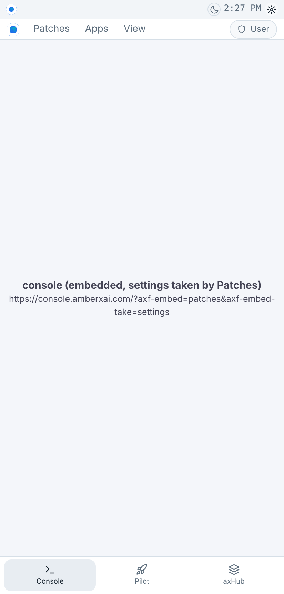
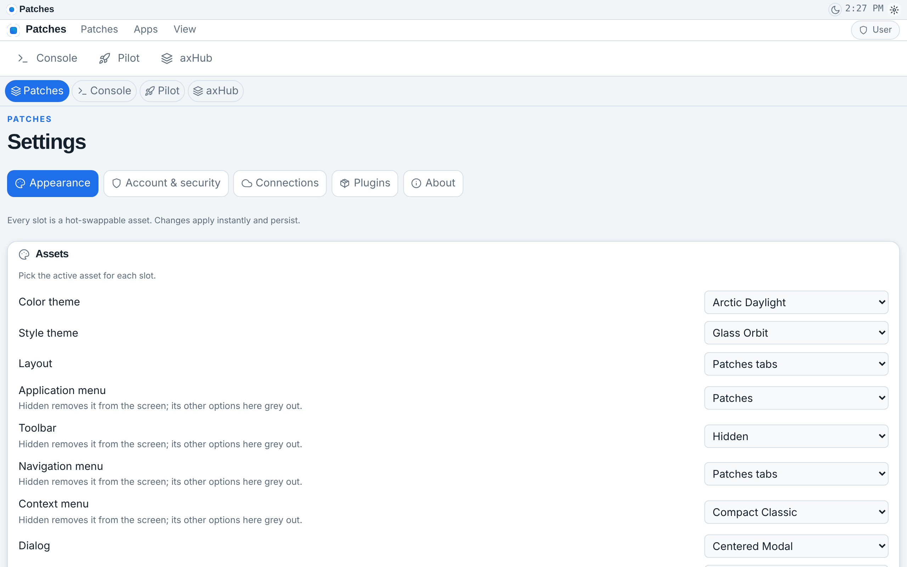
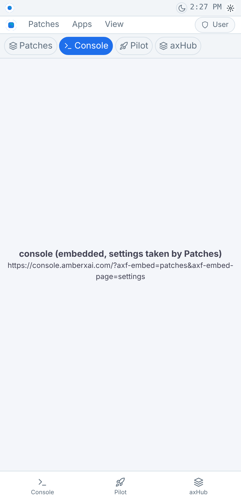
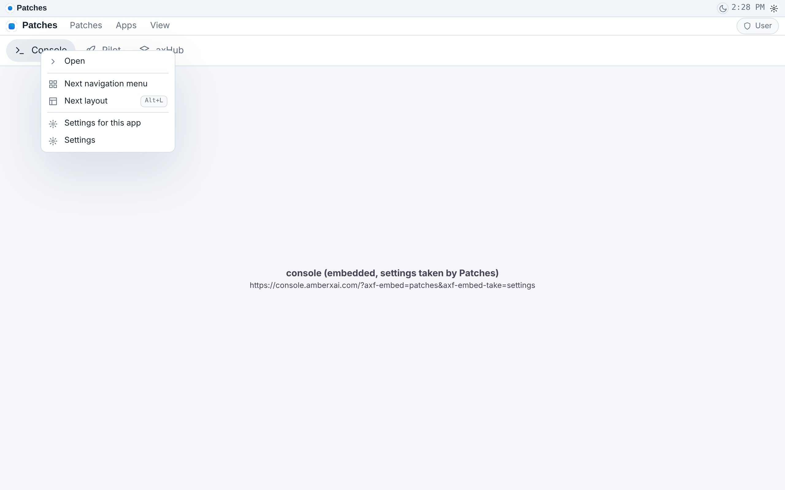

# Patches web + one Settings for every app + Patches serves notifications — report (Opus, Oct 21 2026)

**What Brett asked:** build the web port of Patches; make Patches responsible for serving all Android notifications;
when the Console, Pilot or axHub run inside Patches, take their settings hooks away and combine all three apps'
settings and Patches' own into **one settings interface with 4 tabs** (one per app), with a hook to it in Patches'
**application menu** and **context menu**. Built now on Opus; the Fable rebuild is parked as pending
`patches-web-settings-notify` (Pending Builds page). Build manager entry `chg-20261021-7f3c91a2b4`.

Repos: AmberX-AXF branch `rebuild/patches-web-settings-notify` (on top of `feat/patches-banners`, PR #7), axHub
`feat/embed-host` (PR #2, decision #89), Build-Pilot `feat/patches-settings`.

## In one look

| | |
| --- | --- |
| Patches web, Console tab (phone) |  |
| Combined Settings, Patches tab (desktop) |  |
| Combined Settings, Console tab (phone) — the console's own settings page alone |  |
| Context menu on a tab: *Settings for this app* / *Settings* |  |

(The shots run with axHub and the three apps faked by the screenshot script — the sandbox can't reach the live
sites — so each app tab shows a placeholder naming the exact URL Patches loads.)

## Added — embed@1 extension: what a host takes over (cross-port contract)

- **`takes`**: a host takes app functions over from the apps it embeds. Registry (open, `registerEmbedTake`):
  `settings` (hooks: `app.settings`, `settings.open[:tab]`, `nav:settings`, view `settings`, app-menu live list
  `settings`; has a page) and `notifications` (the app hands its notifications to the host). Carriers:
  `&axf-embed-take=settings,notifications` or a separate user-agent token `AXF-Embed-Take/settings+notifications`.
  Nothing named = nothing taken, so old hosts are unchanged.
- **Page mode**: `&axf-embed-page=settings` = the host shows that page of the app on its own; every chrome type is
  hidden, and the page's own function is never taken (the settings page opens its own tabs).
- **Messages** (`$axf: "embed@1"`): guest → host `open-settings {tab?}`, `notify {title, body?, tag?, level?, link?}`,
  `ready`; host → settings page `open-tab {tab}`. Checked and capped on both ends (`parseEmbedMessage` =
  Kotlin `EmbedTakes.parseMessage`); links only https or `view:` / `settings:`. Web: `postMessage` (host checks the
  sender's frame + origin; guest accepts only from its parent). Android: guest calls `AxfEmbedHost.post(json)`, host
  calls `AxfEmbedGuest.receive(json)`.
- **Runtime (web)**: `rt.hostTakes(fn)`, `rt.takenByHost({action|view|provider})`, `rt.postToHost(msg)`; `dispatch`
  and `navigate` hand taken hooks to the host instead of running them (a toast when no host answers).
- **Chrome drops taken hooks**: app-menu engine (`AppMenuEnv.taken`), `MenuList` (context menus), toolbar items, nav
  items, widgets (an action button goes; a logo/avatar/status loses its tap).
- **`AppShell`**: page mode; new `keep` prop (views kept mounted once shown — frames must never remount).
- Kotlin: `EmbedTakes` (host side + parser) and `Embed(takes, page)` (defaults keep the old shape);
  `EmbedTakesConformanceTest` (written without a compiler — CI compiles it). Guest side on Android deferred
  (`spec/PORTING.md`).
- Fixture `spec/fixtures/embed-takes.json` (new; `embed.json` unchanged). `check-embed.mts` 94 → **236** checks.

## Added — Patches web (`apps/patches-web`, project `patches-web`)

- `axf init … --template web-fastapi-wall --developer` (React/TS + FastAPI behind axHub's wall; look from axHub).
  Assets: `layout/patches-tabs` (menu bar on), `nav-menu/patches-tabs`, `banner/patches`, **`app-menu/patches`**
  (Patches: Settings, *Settings for* ▸ Patches/Console/Pilot/axHub, reload / open the tab in front, About; Apps; View).
- The three apps in frames marked `?axf-embed=patches&axf-embed-take=settings`, kept alive (`AppShell keep`); the
  console's banner strip (`?axf-strip=banners`) in `app.frame.top`, sized by `patches-strip@1` messages.
- **Combined Settings** (view `settings`): tabs **Patches · Console · Pilot · axHub**. Patches = lib-settings' screen
  (+ group Patches: app addresses, console banners). Each app = its own settings page in page mode
  (`axf-embed-page=settings`; axHub = `/auth/account`), kept alive; a sub-tab an app asks for is sent as `open-tab`.
- Hooks: `app.settings` (app menu, banner settings button, Ctrl+,), `patches.settings:<app>[:<tab>]`, context menu
  (default + canvas: *Settings*, *Reload*; a tab: *Settings for this app*, *Settings*).
- Deploy: `sudo bash apps/patches-web/deploy/install.sh` → `https://patches.amberxai.com` (clones AmberX-AXF, builds
  the app folder; no repo of its own — `patches-web` is only reserved). Needs a DNS record for `patches` and, on
  axHub, `AXHUB_EMBED_FRAME_ANCESTORS=https://patches.amberxai.com`.

## Changed — Patches Android (`apps/patches`)

- `WebAppHolder("patches", takes = [settings, notifications])`; tabs get `onMessage` (lib-hub bridge).
- View `settings` = **CombinedSettings** (same 4 tabs; app tabs are web views `settings:<app>` in page mode).
- App menu shown (layout `showMenubar`, manifest no longer hides `app-menu`; asset `app-menu/patches`, static on
  Android). Context items via `addContextItems` (default + nav-item with `patches.settings:{payload}`).
- **Patches serves the phone's notifications**: `NotificationsModule` + `WorkModule(PatchesWatch)`: one lib-work job
  = hub approvals feed (alert per new approval, cleared when decided) + the console's `/api/alerts` (errors and
  warnings, once per change, cleared when resolved/read; console cookies, redirects never followed, 512 KB cap) +
  what an app in a tab sends (`notify`). Setting **Serve all notifications** (default on); POST_NOTIFICATIONS asked
  once; a tapped notification opens the right tab. Channels: watching, approvals, console alerts, from the apps.
- **AXHub app stays quiet while Patches is installed** (`ApprovalWatch.patchesInstalled`, manifest `<queries>`);
  it still tracks seen approvals so nothing old pops up later.
- lib-hub: `WebAppHolder(takes)`, `WebAppView(onMessage)` (`AxfEmbedHost` bridge, believed only while the page is on
  the tab's origins), `WebAppHolder.send(tab, json)`.

## Other repos

- **axHub** (PR #2, decision #89): reads the mark by convention; inside a host: no brand; `take=settings` drops the
  **Account** link (its settings hook); page mode = page alone; framing by a host opt-in
  (`AXHUB_EMBED_FRAME_ANCESTORS`). 326 tests.
- **Build Pilot** (`feat/patches-settings`): framework re-baked (gets takes + page mode; widget-kind starters it
  lacked added), contract bake reads the Python contracts from `framework/python/axf/contracts/`. typecheck clean,
  contract tests 16, server self-test 283. Merge after AmberX-AXF.
- Console: banner strip talks to a web host through `patches-strip@1` messages (Android bridge unchanged); baked
  framework refreshed. `web-fastapi-wall` template: developer apps attach the hub look (typed through `AxfManifest`).

## Tests

| Suite | Before | After |
| --- | --- | --- |
| `framework/spec/check-embed.mts` | 94 | 236 |
| check-app-menu / check-widgets / check-hub / check-appearance | 113 / 215 / 183 / 74 | unchanged, pass |
| Kotlin `EmbedTakesConformanceTest` | — | new (CI) |
| axHub `pnpm test` | 321 | 326 |
| Build Pilot server self-test / contract tests | 283 / 16 | 283 / 16 |
| console typecheck + build + menu-reach (165) | pass | pass |

## Known gaps

- Kotlin written without a compiler (no Gradle plugin access here): CI is the compiler; check the "CI build errors" issue.
- On Android, Patches' app menu is the static asset (the app-menu engine's Android twin is still deferred).
- The console's web push / ntfy still reach the phone too: turn them off in the console (Settings → Alerts) if
  Patches' notifications are enough.
- Web Patches takes only `settings` (browsers keep their own notifications).
- The Fable rebuild (pending `patches-web-settings-notify`) redoes the contract + bridges.
