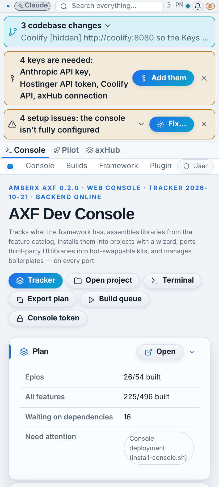
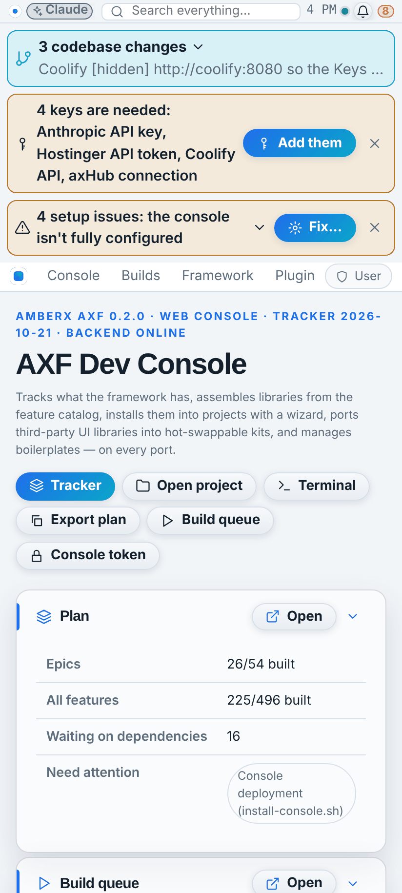
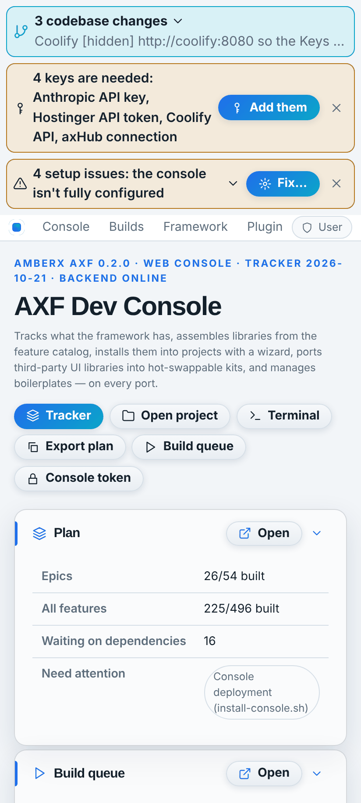
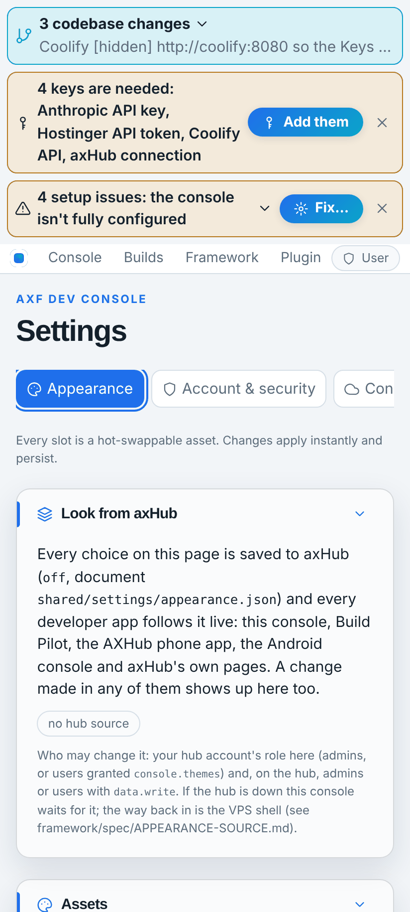

# Patches — differences report (pending `patches-wrapper`, Fable, Oct 21 2026)

**What Brett asked (voice, Oct 21 2026):** take the Console / Pilot / axHub tab group out of the console so the
Console, Pilot and axHub are each their own app again; make a new app, **Patches**, that is just one banner and a tab
group showing the three apps in tabs; when an app runs inside Patches its own banner goes away and Patches shows the
one banner. Android first. Design he picked: **native shell, web tabs**.

Branch `fable/patches-wrapper`. Web screenshots in [`patches-wrapper/shots/`](patches-wrapper/shots/) (before = commit
`5d95cd0`, after = this build); Android screenshots arrive by themselves on the branch (`patches-wrapper/android.md`,
`rebuild-shots.yml`) once it is pushed.

## In one screen

| | Before | After |
| --- | --- | --- |
| Dev Console (phone) |  banner + **Console · Pilot · axHub** tab row |  banner, no tab row |
| Dev Console inside Patches | — (nothing embedded anything) |  **no banner**: Patches shows the one banner; plugin banners (changes, keys, setup) and the app menu stay |
| Settings → Appearance inside Patches | — |  the Banner slot reads *Shown by patches* and is greyed out |

## Removed

- **App tabs plugin** (`apps/console-web/plugins/app-tabs`, Opus build of Oct 19 + the axHub tab of Oct 20 + the
  "banners above the tab group" change of Oct 21 morning): `uninstall.mjs --all` (8 files), its two marked doc lines,
  `node framework/cli/plugin-lifecycle.mjs check app-tabs --after-uninstall` = clean. Its settings keys
  (`app-tabs.tabs|custom|active`) are orphaned in saved console settings; harmless, nothing reads them.
- The console's Apps menu entries *Show … in a tab / Back to the console / App tabs ▸* and action `app-tabs.show:<id>`
  (they came from the plugin's `menu.ts`). The Apps menu still opens Pilot and the hub pages in a new browser tab
  (`console.open:<key>`).
- The hub setting `AXHUB_APPS_FRAME_ANCESTORS=https://console.amberxai.com` is no longer needed for the console
  (nothing frames the hub from the console any more; Patches loads the hub in a web view, which no frame-ancestors rule
  affects).

## Kept

- The page slots the plugin had needed, `app.frame.top` / `app.frame.cover` / `app.frame.banners` (`AppShell.tsx`,
  `Slots.tsx`): other plugins may use them; wording no longer mentions app tabs.
- Every other console plugin, banner and view: pixel-identical standalone (after shot = before shot minus the tab row).
- The web `rebuild-shots.mjs` tool: additive options only (`path`, `userAgent` per shot).

## Added — embed@1 (cross-port contract)

An app can now run inside another app's frame and know it.

- **Reference engine** `framework/core/engines/embed.ts` = Kotlin `ai.amberx.axf.kernel.engine.EmbedEngine`; fixture
  `framework/spec/fixtures/embed.json` (hosts, hidden lists, queries, user agents, detect precedence, suffixes, urls),
  replayed by `framework/spec/check-embed.mts` (94 checks, in CI) and `EmbedConformanceTest` (Kotlin, written without a
  compiler — CI compiles it).
- **The marker**, two carriers, the query winning: `?axf-embed=<host>[&axf-embed-hide=<type>,<type>]` or a user-agent
  token `AXF-Embed/<host>[/<type>+<type>]`. `<host>` = `[a-z0-9][a-z0-9-]{0,31}` (lower-cased); hidden types are cleaned
  to hideable chrome in spec order; nothing valid named = the default (`banner`); `none` = hide nothing; no valid host =
  no marker. Host helpers `userAgentSuffix(host, hidden)` and `embedUrl(url, host, hidden)` build the marker.
- **Hide engine forced layer**: `hiddenSlots(overrides, defaults, forced)` on both ports (`hide.ts`, `HideEngine.kt`);
  `spec/fixtures/hide.json` gained three `forced` cases (an override can't undo it; non-hideable names ignored).
- **Runtime** (both ports): `AxfRuntime.embedded` (web: detected from the page when the option is omitted — `location.search`
  + `navigator.userAgent` —, or passed; Kotlin: constructor `embedded =`), `embedHiddenSlots()`, `slotHiddenByHost(type)`,
  `hiddenSlots()` = host's chrome over the user's overrides over the app's defaults; `setSlotHidden` on host-shown chrome
  refuses with an info toast ("patches shows the banner for this app while it runs inside it") and writes nothing, so the
  user's own choice is there when the app runs on its own. `rt.banner()` is empty and `--fx-banner-h` is `0px` while the
  banner is hidden this way (the existing hide path; nothing new to render).
- **UI**: web `AppShell` marks `.fx-frame[data-axf-embed="<host>"]` (styles/plugins can adapt); lib-settings' slot picker
  and the Compose settings chips grey the slot out and label the choice *Shown by <host>*.
- **Not changed**: engines, fixtures and layouts for everything else; `manifest.hidden`, the appearance document
  (the forced layer is never pushed to the hub), Build Pilot (bakes the framework: it gets embed@1 on its next
  `bake-contracts` / re-bake, step listed below), axHub's own pages (not AXF; they keep their header inside Patches —
  a hub-side change if Brett wants it gone).

## Added — Patches (`apps/patches`)

- `axf init apps/patches --template android-compose --developer https://axhub.amberxai.com --libraries hub`: app id
  `patches`, package `ai.amberx.axf.patches`, project manifest `patches` (repo `MossesX/patches` reserved, `exists: false`),
  hub folder `/projects/patches`. Validates (`axf validate`: 69 assets; `axf project validate --all`: 7 projects clean).
- Own assets: `layout/patches-tabs` (nav top, no menubar / toolbar / status / inspector, full width; mobile `top-tabs`,
  no app bar), `nav-menu/patches-tabs` (pills, bar indicator: **Console · Pilot · axHub**), `banner/patches` (28 px: the
  Patches mark; right: day/night switch, clock, settings button). Manifest hides `toolbar` + `app-menu`; starts on `console`.
- Code: `App.kt` (modules + `HubModule` with the WebView cookie credentials → look + settings from the hub, waits for it),
  `AppModule.kt` (three routes, Settings → **Patches**: Console / Pilot addresses (https host only, bad = default),
  *Reload the tab in front*, *Open the tab in front in the browser*; placeholders `patches.native-tabs`, `patches.web`,
  `patches.bridge`), `views/TabView.kt`, `MainActivity.kt` (owns the `WebAppHolder("patches")`, hub sign-in on the
  waiting screen, destroys the views when finishing).
- **lib-hub `WebAppView` + `WebAppHolder`** (`framework/android/lib-hub/.../WebAppView.kt`): a web *application* view
  (JavaScript + DOM storage on, cache on, media needs a gesture) locked to an origin **list** (the app's + the hub's, for
  the sign-in wall's round trip; other http(s) → the phone's browser; a redirect off the list is stopped before it
  renders; nothing loads at all off the list), user agent + `AXF-Embed/patches`, no file/content access, no mixed content,
  third-party cookies off, safe browsing on, downloads only through `hubApkDownloads`. The holder keeps one WebView per tab
  for the activity's life and reparents it on tab switches (page, scroll and state survive), exposes `loading` / `url`
  flows per tab, `reload(tab)`, `drop(tab)`, `destroy()`. `LockedWebView` (hub pages, no JS) is unchanged.
- CI: `android.yml` already builds every app `app-bundle.mjs list --android` finds; added the named artifact
  `patches-debug.apk`. The app catalog on the hub gets Patches on the next green main.
- Catalog: `k.embed` (built, kernel), `c.patches` (built, apps/patches), note on `w.webview`; tracker regenerated.

## Contract / API / asset / fixture changes

| What | Change | Compatibility |
| --- | --- | --- |
| `hiddenSlots(overrides, defaults, forced = [])` (TS + Kotlin) | new optional third argument | additive; old calls unchanged |
| `AxfRuntimeOptions.embed` (TS), `AxfRuntime(embedded =)` (Kotlin) | new optional | additive; web auto-detects from the page when omitted (an app that must never embed passes `null`) |
| `rt.embedded`, `rt.embedHiddenSlots()`, `rt.slotHiddenByHost()` | new | additive |
| `setSlotHidden` | refuses host-shown chrome | only while embedded |
| `.fx-frame[data-axf-embed]` | new attribute | additive |
| `spec/fixtures/hide.json` | +3 forced cases | Kotlin `ConformanceTest` reads the optional `forced` key |
| `spec/fixtures/embed.json` | new | — |
| `rebuild-shots.mjs` | per-shot `path`, `userAgent` | additive |
| `gen-fixtures.mts` | **fixed**: the app-menu block never closed (the generator had been failing at HEAD); embed + forced cases added | regenerated fixtures identical except hide.json / embed.json |

## Migrations / adoption

- **Build Pilot** (separate repo): re-bake the framework (`scripts/bake-contracts.mjs` / its `src/axf` copy) to get
  `embed.ts` + the runtime change; nothing else — its AppShell is the framework's. Until then Pilot keeps its banner inside
  Patches' Pilot tab.
- **axHub** (separate repo, not AXF): optional — read the same marker (`AXF-Embed/<host>` in the user agent, or
  `?axf-embed=`) and hide its own header, if Brett wants the hub tab bannerless too.
- **Hub**: `AXHUB_APPS_FRAME_ANCESTORS=https://console.amberxai.com` can go.
- **Pending list on the hub**: the copy `axhub.memory_read(project amberx-axf, data, framework/plan/pending.json)` held
  **10 items** (first version 14:07 UTC today, written over MCP) while the repo snapshot holds **21** with every
  sub prompt and estimate. Something wrote a short list over the hub's. This build added `patches-wrapper` to the **repo
  snapshot** only; on the VPS run `claude-sync status` and keep the right copy before the console's Pending view is trusted.

## Tests

| | Before | After |
| --- | --- | --- |
| `check-embed.mts` | — | 94 |
| `check-widgets` / `check-appearance` / `check-app-menu` / `check-hub` | 215 / 74 / 113 / 183 | same |
| `axf validate --framework` | 66 assets | 66 |
| `axf validate apps/patches` | — | 69 assets |
| `axf project validate --all` | 6 projects | 7 |
| console `tsc --noEmit`, `vite build`, `menu-reach.mts` (165), `check-theme` (272 files) | pass | pass |
| Kotlin: `ConformanceTest` (hide forced cases), `EmbedConformanceTest` (engine + runtime), lib-hub, apps/patches | written without a compiler | CI compiles; check the "CI build errors" issue |

## Known gaps

- Android screenshots ([android.md](patches-wrapper/android.md), run 14): the emulator capture never got past the launcher for **any** app, before or after (every screen `?`, the Android console at the base commit included), so this is a capture-pipeline fault, not Patches'; the APKs themselves built. Worth a look at `rebuild-shots.yml` / `boilerplate-capture.py` on its own (launch intent or demo-mode step). Patches' web tabs would show the waiting screen / sign-in there anyway (no hub session on the emulator).
- No tab badges yet (approval counts etc.): `patches.bridge` placeholder.
- The hub tab keeps the hub's own header (axHub isn't AXF).
- Native Console / AXHub modules inside Patches: `patches.native-tabs` placeholder (the Android hold still covers those apps).
- Embedded apps' plugin banners stay (by design: they are notices, not "the banner").
