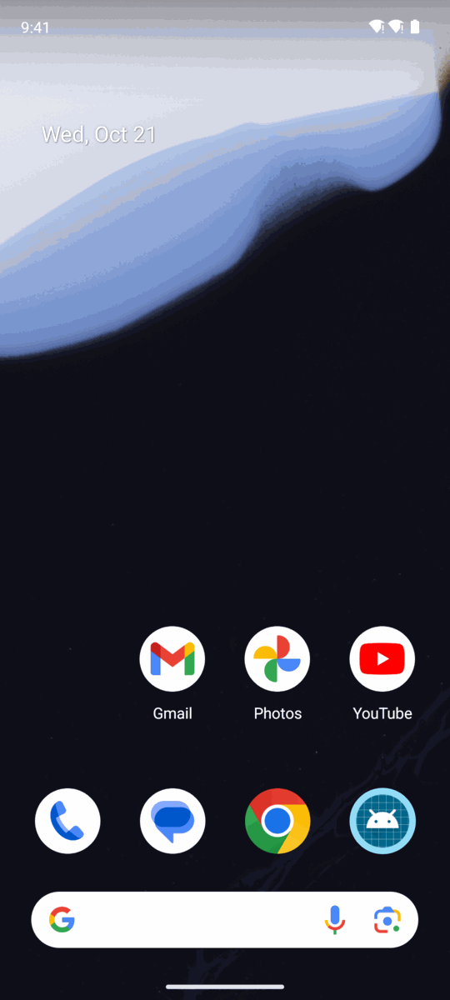

# Android screenshots — before / after

Captured automatically by `.github/workflows/rebuild-shots.yml` on an API 34 emulator (Pixel 6, demo-mode status bar).
Before = `71807f6a398f`, after = `4eb8b48efbe7` — [run](https://github.com/MossesX/AmberX-AXF/actions/runs/39545723165). ✓ = the capture reached that screen through the app's own nav; ? = it didn't (e.g. an app lock in front).

## axf-console-android

| Screen | Before | After |
|---|---|---|
| Start | ✓  | — |
| Home | ?  | — |
| Tracker | ?  | — |
| Features | ?  | — |
| Libraries | ?  | — |
| Demos | ?  | — |
| Modules | ?  | — |
| Boilerplates | ?  | — |
| Assets | ?  | — |
| Components | ?  | — |
| Designer | ?  | — |
| Layouts | ?  | — |
| Roles | ?  | — |

## axhub-android

| Screen | Before | After |
|---|---|---|
| Start | ✓  | — |
| Approvals | ?  | — |
| Hub | ?  | — |
| Apps | ?  | — |
| Services | ?  | — |
| Jobs | ?  | — |
| Audit log | ?  | — |
| Vault | ?  | — |
| Users | ?  | — |
| Projects | ?  | — |
| Devices | ?  | — |
| Settings | ?  | — |

## voice-vault

| Screen | Before | After |
|---|---|---|
| Start | ✓  | — |
| Voice | ?  | — |
| Saved sites | ?  | — |
| Voice triggers | ?  | — |
| Settings | ?  | — |
