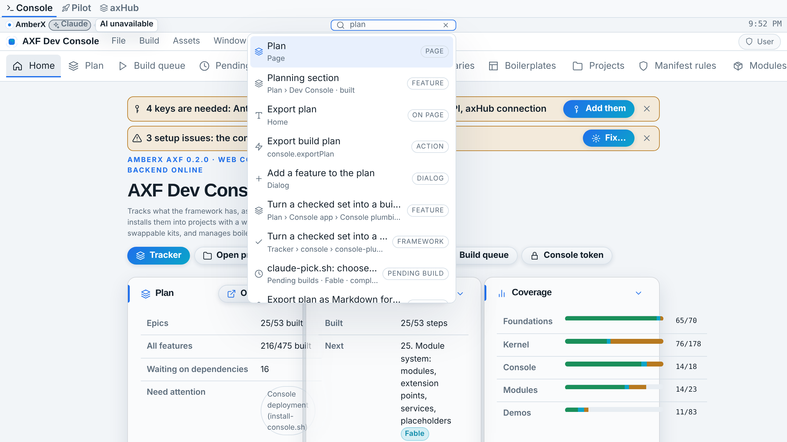
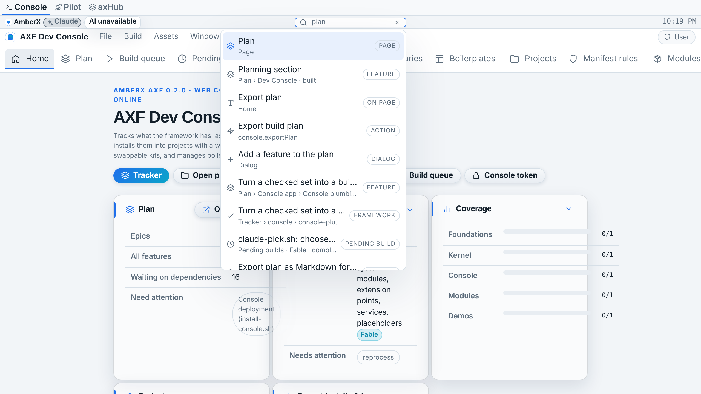
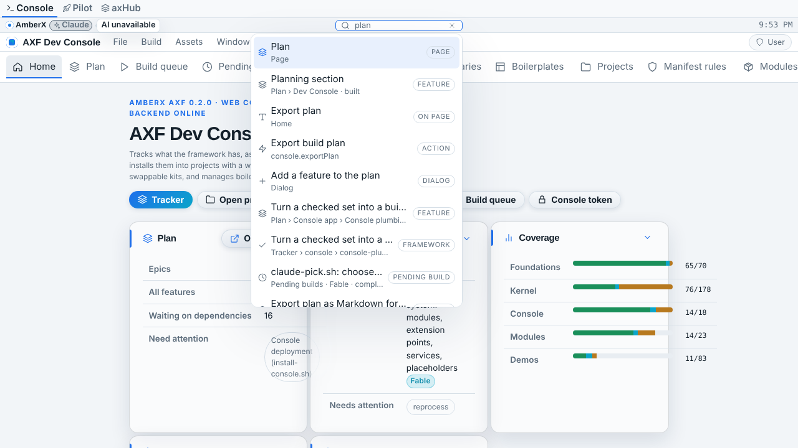
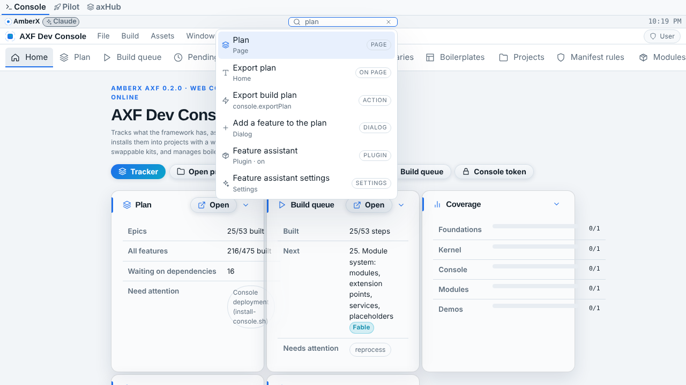
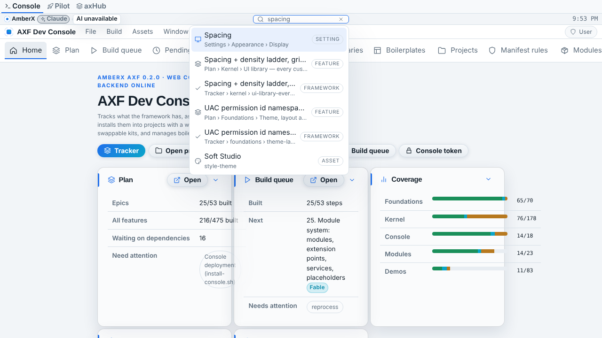
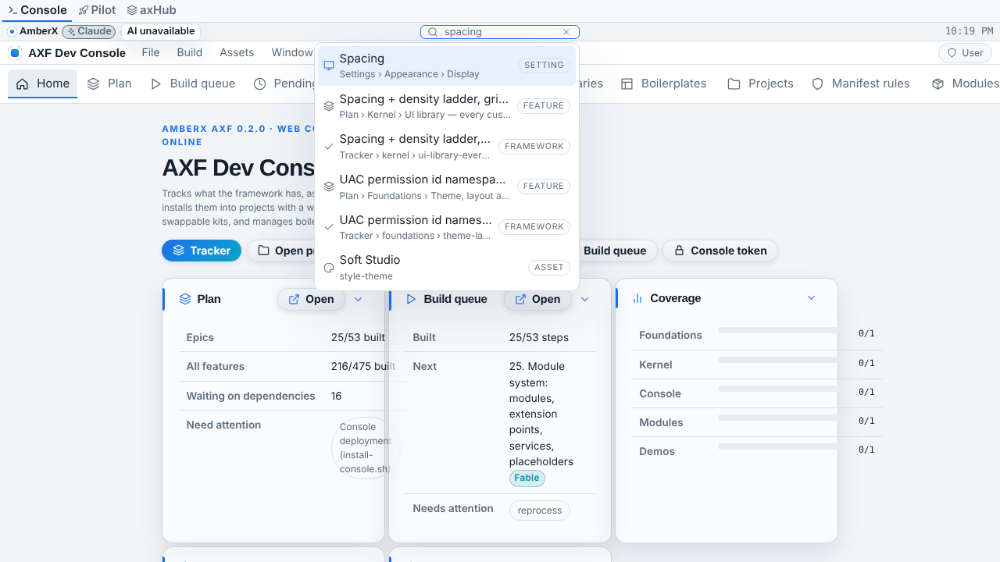

# Fable rebuild: `widget-assets` (Oct 20 2026, branch `fable/banner-widgets`)

Built on `banner-assets` (same branch, see `banner-assets.md`). Widgets (`clock`, `search-bar`) and their hosts (banner, toolbar) now run on one **spec-driven, open host registry**: `asset-types.json` declares what each host takes (`attach` / `widgets` blocks) and the engine, the three validators and both ports read that one definition; a library can register another host or another widget type without touching the kernel or the shell. The search bar's config is normalized identically on both ports (`searchBarConfig`: defaults, `maxResults` clamped 1–50, bad `kinds` dropped). The big addition is **Android**: the Compose search bar and toolbar widgets, a live-search popover on the kernel `SearchIndex`, the search host that feeds views/dialogs/windows/settings into the index and focuses picks, and the Android console's own providers — `k.search` moves from partial to built. Existing `widgets.json` entries are byte-identical; four sections were added.

## Removed
- Nothing public. `WIDGET_TYPES`/`TOOLBAR_SIDES` literals are now derived from the spec (same values, same exports).

## Kept
- Asset type `search-bar` (fields, enums, optional fields), `"widget": true` on clock + search-bar, group "Widgets".
- Starters `search-bar/everything` (default), `search-bar/compact`; both banners keep `everything` in the centre.
- `toolbar.widgets` field and `toolbar.search.live`; Ctrl/Cmd+K and `/` on the web.
- Runtime names on both ports: `attachToToolbar`, `detachFromToolbar`, `toolbarWidgets()`; React `WidgetView`, `SearchBarWidget`, `LiveSearch`, `useSearchHost`; CSS `.fx-widget-search`, `.fx-toolbar__widget`.
- `apps/console-web/src/consoleSearch.ts` providers (plan features, tracker, pending builds, plugins) unchanged.
- `spec/fixtures/widgets.json` and `search.json` existing entries byte-identical.

## Changed
- `framework/core/engines/widgets.ts`: `WIDGET_TYPES`, `ATTACHABLE_ASSET_TYPES` and the two hosts are read from `asset-types.json`; new `HostSpec`, `registerHost/hostSpec/hostSpecs/isHost`, `placeHost(host, data, extra, has, requireHost)` (toolbar keeps the "no toolbar → nothing" rule, banner keeps its "run-time entries still place" rule from the first version), `validateHostAttachments`, `searchBarConfig`, `SEARCH_BAR_MAX_RESULTS`. `placeToolbarWidgets` is now a wrapper.
- `framework/core/runtime.ts`: `attachToToolbar`/`toolbarWidgets` use the generic host store (see banner report).
- React `Widgets.tsx`: `registerWidgetRenderer(type, Component)` open registry; `WidgetView` takes `host` so a renderer can adapt (toolbar vs banner); `SearchBarWidget` uses `searchBarConfig`. `Chrome.tsx` passes `host="toolbar"` and `data-axf-origin`.
- Kotlin `WidgetEngine.kt`: `HostSpec`, host registry (`registerHost`, `hostSpec`, `loadHosts(types, specJson)` called by `AssetTypeRegistry.loadSpecJson`, so a module's own spec file can add hosts), `ownAttachments`, `placeHost`, `validateHostAttachments`, `searchBarConfig`, `SearchBarConfig`.
- Kotlin `SearchEngine.kt`: `SearchFocuser` + `SearchIndex.setFocuser/focusWithUi` (web parity), text-hit dedupe (a page word that names a listed result is dropped, as on the web), `KIND_LABELS` is now mutable with `labelKind()` so modules add their kinds (web: `Object.assign(SEARCH_KIND_LABELS, …)`).
- Kotlin `AxfRuntime.focusSearch(entry)`: runtime fallback (view/text/action/setting/dialog/asset/window) = web `SearchIndex.focus`.
- Kotlin `Models.kt`: `Toolbar.liveSearch` (from `data.search` with `live: true`), so a toolbar asset's live search works on Android like on the web.
- Kotlin `DialogContribution.searchable` (default true; placed before `content` so trailing-lambda callers are untouched) = web `DialogDef.searchable`.
- lib-settings: `axf.settings` search provider (groups + single settings, `requires` carried), action `settings.open:<group>[:<key>]`, `SettingsEngine.focusRequest`; `SettingsScreen` scrolls to the group and filters to the setting on a pick.
- Catalog `k.search`: partial → built.

## Added
- Android `axf-ui/components/Widgets.kt`: `WidgetRenderers` registry, `AxfWidget`, `AxfClock` (minute-aligned ticks, IANA zone via `java.util.TimeZone`, same text as the web through `BannerEngine.formatClock`), `AxfSearchBar` (width = space token × engine number).
- Android `axf-ui/components/Search.kt`: `AxfLiveSearch` (results on every keystroke in an `AxfPopover`, up/down/Enter/Escape on hardware keyboards, IME Search picks, locked hits toast, kind chips), `AxfSearchHost` (views with icons/keywords, dialogs, open windows → index; focuser for windows and the asset gallery), `LocalAxfSearchHost`, `SearchShortcuts` (Ctrl/Cmd+K from `AxfRoot`; `/` deliberately not taken at the root because the root can't tell whether a text field has focus).
- Android `AxfToolbar`: widgets at start/end (`runtime.toolbarWidgets()`), live search when `liveSearch` is set, classic box otherwise.
- Android `AppShell`: `viewIcons`, `viewKeywords`, `dialogs` params; installs the search host.
- Android console: `ConsoleSearch.kt` (tracker items, catalog features → kinds `framework-feature`, `feature`), `MainActivity` passes view icons + keywords.
- Fixtures `widgets.json` + `hosts`, `attachableTypes`, `searchBarConfig` (6 cases incl. clamping, bad enums, bad kinds, non-boolean shortcut), `attachValidation` (6 cases); `validation.json` + 3 host cases. `check-widgets.mts` (web, CI) and the Kotlin `ConformanceTest` replay all of them.

## Contract / API / fixture changes (old → new)
| Area | Old | New |
|---|---|---|
| Host definition | literals in two engines | `asset-types.json` `attach`/`widgets` blocks → open host registry (both ports) |
| `toolbar.widgets` validation | none | validated on all validators |
| `search-bar` config | read raw by the UI | `searchBarConfig()` normalized (clamped 1–50, kinds filtered) on both ports |
| Widget renderers (web) | `if/else` in `WidgetView` | `registerWidgetRenderer` registry |
| Kotlin `SearchEngine.KIND_LABELS` | immutable `Map` | `MutableMap` + `labelKind()` |
| Kotlin `DialogContribution` | no `searchable` | `searchable = true` added (before `content`) |
| Kotlin `Toolbar` | no live search | `liveSearch: SearchBarConfig?` |
| Android search UI | none (`k.search` partial) | banner/toolbar live search + host + settings/console providers |
| Fixtures `widgets.json` | 5 sections | 9 sections (old 5 unchanged) |

Migration: none for apps. A Kotlin caller constructing `DialogContribution` positionally with four arguments would need the named `content =` (none exist in the repo). The Kotlin `ConformanceTest` now also runs `AssetTypeRegistry.builtin()` before comparing hosts (so the spec's hosts are loaded).

## Tests
- Before (Opus): see banner report; `widgets.json` 5 sections, replayed only by the (never compiled) Kotlin test.
- After: `check-widgets.mts` 93 checks (web); Kotlin engines compiled with standalone kotlinc 2.0.21 + stub and replayed banner/widgets/search fixtures: 88 checks ok; `tsc` clean, vite build ok, all CLI checkers pass (see banner report). Kotlin UI/runtime/tests: parse-checked; full compile on CI.

## Security
- Search results stay UAC-gated on Android exactly as on the web (`SearchIndex.query` drops `hide`, marks `disable`; the UI refuses a locked pick). Settings entries carry their `requires`. No new routes, nothing on MCP.

## Screenshots (web console)
The web search bar is visually the same; the rebuild changed engines, validation and Android.

| | before | after |
|---|---|---|
| Search "plan" phone |  |  |
| Search "plan" desktop |  |  |
| Search "spacing" (settings hit) desktop |  |  |

Android screens affected (Android screenshots pending CI): banner search bar + results popover (Android console, phone and desktop window classes), toolbar widgets (start/end) and toolbar live search, Settings screen after a search pick (scrolled + filtered), Tracker/Catalog opened from a search hit.

## Known gaps
- Android "words on the page" provider (web `axf.text`) is not built: Compose has no DOM to scan; a `data-axf-search`-like semantics scan is a later step.
- Android `/` shortcut not taken at the root (see above); Ctrl/Cmd+K works with a hardware keyboard.
- Android settings anchors scroll to the group and filter by label; there is no flash animation.
- Android screenshots and the full Kotlin compile depend on CI (no Maven here).
