# windows-terminal — Fable phase (window engine + settings levels)

Orchestrator build `windows-terminal` (Refactor profile), steps s6–s12 = refactor-all s17–s23, Fable, branch
`refactor-all/wt-s23b` (base commit `34238fed`, which already holds the Opus phase: Terminal plugin v0.3.0, see
[windows-terminal.md](windows-terminal.md)). Asked by Brett (Oct 28 2026): windows that resize from every edge, maximize,
snap like Windows, a frameless Terminal whose tab strip is its title bar; and every settings interface with a hideable
Simple / Basic / Developer / Administrator toolbar plus a level editor (rule "Every settings interface has a level
toolbar"). **apply-all-levels-fable s3 (settings-ui@1 levels review) is folded in** here: the levels engine was reviewed
and rebuilt by s20–s22, so that step is done by this build; its s1, s2 and s4 (look@1 fixture, banner Apply to all) are
not touched.

Commits: `a2c5f30e` s17 resize / maximize / frameless · `8926cb8b` s18 snapping · `0a6c193f` s19 lib-workspace on the
engine · `e8d1b0d3` s20 levels + visible sets · `3265d06c` s21 level toolbar · `ccc5cd76` s22 level editor · s23 (this
report) re-bake, shots, report.

## Differences

**Removed**
- The host title bar, window toolbar and tab-group bar above the Terminal: a `frameless` window shows only the content's
  own bar (the Terminal strip, with caption buttons). s23 also hides the host's tab-group bar for a single-tab frameless
  window (it came back as a second title bar in the first s23 shots); a second tab dropped in brings the bar back.
- lib-workspace's own floating-pane clamp, `WindowResizeHandles` copy and CSS `resize` (s19): panes run on the window
  engine's geometry.
- Settings level names **Pro** and **Advanced** (migrated, see below).

**Kept**
- Every Opus-phase Terminal feature (tab strip, ∨ menu, command toolbar, Windows keys, connections, profiles, settings).
- Standard-frame windows (every other floating window): same title bar, now with resize handles and a maximize button.
- Window menu, minimize to corner / floating toolbar, redock, grid / tree mode, window settings dialog.
- Settings interfaces: tabs, search, groups, Restore look; the level toolbar is additive and hideable (`axf.settings.levelbar`).

**Changed**
- `WindowSpec` gains `frame`, `maximized`, `restore`, `minWidth`, `minHeight`; `openFloating(..., opts)`.
- Drag physics: the engine snaps from the unsnapped pointer position each step (no accumulated pull); a maximized window
  restores under the pointer when dragged; **windows may leave the screen** (no viewport clamp, Brett Oct 28).
- Settings levels: `SETTINGS_LEVELS = simple | basic | developer | administrator`; Administrator shows everything;
  settings outside the picked level sit in a second collapsible container ("More settings") instead of disappearing.
- Double-tap / double-click a title bar = maximize / restore (Windows).

**Added**
- Window engine (`framework/core/engines/windows.ts`): `RESIZE_EDGES` (8), `hitResizeEdge`, `resizeCursor`, `resizeRect`,
  `maximizedRect` / `maximizeWindow` / `restoreWindow` / `toggleMaximized` / `dragRestore`; snapping `SnapRules`,
  `snapRect` (screen + window edges), `SNAP_ZONES` / `snapZoneAt` / `snapZoneRect` (half / quarter, top = maximize),
  `resolveOverlap`, `splitDrop` / `topmostAt` / `armSplit` (drop onto a window after a dwell → split), `WindowState.preview`;
  manager `resizeFrom`, `setMinSize`, `setFrame`, `maximize` / `unmaximize` / `toggleMaximize`, `dragTo` / `settle` /
  `snapTo` / `splitOnto` / `setSnapRules`, `workArea`; actions `windows.maximize`, `windows.snap`; window menu Snap submenu.
- React (`WindowHost.tsx`): 8 pointer + touch resize handles (frameless content gets them too), maximize / restore
  button, `useWindowFrame()` hooks for frameless content, `SnapPreview` layer (tokens + `--fx-opacity-tint`).
- Terminal: frameless window; the strip drags, right-clicks as the title bar and carries minimize / maximize / close.
- lib-workspace: `dragFloatTo` / `settleFloat` / `resizeFloatFrom` / `maximizeFloat` / `restoreFloat` / `minimizeFloat` /
  `snapFloatTo`, `FloatRect.maximized` / `restore` / `minimized`, `FLOAT_MIN`.
- settings-ui@1: `SETTINGS_LEVEL_MIGRATION`, `settingsLevelOf`, per-level visible sets (`visible: { <level>: { show, hide } }`),
  `normalizeSettingsVisible`, `mergeSettingsVisible`, `withSettingsVisible`, `setSettingsVisible`, `settingsItemLevel`,
  `settingsVisibleAt`, `shownAtLevel`, `settingShownAtLevel`, `splitSettingsGroup`.
- lib-settings: level toolbar on every settings interface (Segmented picker, hint, Edit levels, ⋯ menu with Hide; context
  target `settings-levelbar`; actions `settings.level`, `settings.levelbar`), **Settings levels** dialog (`levels.tsx`):
  left a sorted, categorised tree of every setting (coloured by on / off at the level, multi-select, Add to visible /
  Remove buttons and right-click), right the tree of what is on; the settings page updates live.
- Fixtures `spec/fixtures/windows.json` (new) and `settings-ui.json` (cases `visible*`, `level`, `shown`, `split`,
  `set-visible`), `spec/check-windows.mts` (new), `check-settings-ui.mts` extended, CI steps.
- s23: `rebake.mjs` also bakes `libs/` when an app ships `src/axf/libs` (as CI does), so status / apply match the lock.

## Contracts and fixtures

| Contract | Change | Fixture |
|---|---|---|
| windows@1 | additive fields on `WindowSpec` (`frame`, `maximized`, `restore`, `minWidth`, `minHeight`), new pure functions and manager methods, `WindowState.preview` | `windows.json` new: resize, maximize, snap, zones, split, workspace sections — `check-windows.mts` 383 checks |
| settings-ui@1 | level ids renamed (`pro` → `administrator`, `advanced` → `developer`), additive `visible` field + saved setting `axf.settings.visible`; Administrator shows all | `settings-ui.json` 31 → 43 checks |

Wire and asset formats stay readable by the old engines: unknown fields are ignored, and the old level ids are still
accepted on the way in.

## Migrations

- **Pro → Administrator, Advanced → Developer:** `settingsLevelOf` migrates in assets (`settings` asset levels and group
  levels), in saved picks (`axf.settings.level`) and in visible sets. Nothing to run; old values map on read.
- Saved window layouts without `frame` / `maximized` load as standard, not maximized.
- lib-workspace floats without `maximized` / `restore` load as before; `FLOAT_MIN` applies on the next resize.

## Compatibility notes for apps

- Re-baked in this step (framework → `src/axf`): **console-web, axhub-web, walkthrough-studio, amberx-droid, demo** — all
  typecheck and build. **patches-web is left alone** (Patches paused, its baked copy stays).
- `apps/demo` was on a pre-banner framework: its `axf.manifest.json` `defaults` now carry every slot added since
  (merged from `framework/defaults.json`, the demo's own picks kept) and the missing starter asset folders were copied in,
  otherwise `AxfManifest` no longer typechecked. 39 → 446 assets, `axf validate` passes.
- Apps that open floating windows get resize handles and maximize for free; a window that must stay inside the viewport
  should set `minWidth` / `minHeight` and its own snap rules (`setSnapRules`), as the engine no longer clamps.
- Any app settings asset still naming `pro` / `advanced` keeps working (migrated on read); update it at leisure.
- Plugins that drew their own level picker should drop it: the toolbar comes from lib-settings on every interface.

## Tests before → after

| Check | before (`34238fed`) | after |
|---|---|---|
| `check-windows.mts` | — (new) | 383 |
| `check-settings-ui.mts` | 31 | 43 |
| `check-theme.mjs` | pass | pass (553 files, 87 tokens) |
| `check-controls.mjs` | pass | pass |
| `check-feature-matrix.mjs` | 30 | 30 |
| console typecheck + build | pass | pass |
| axhub-web / walkthrough-studio / amberx-droid / demo build | pass (old bake) | pass (new bake) |

## Screenshots

Captured with `framework/cli/rebuild-shots.mjs` ([shots.json](windows-terminal-fable/shots/shots.json);
before = `34238fed` in a temporary worktree with `shots-before.json`, after = this branch), `AXF_APPEARANCE_HUB=off`
(the sandbox has no axHub, so the console runs on local settings).

| | before | after |
|---|---|---|
| Terminal window |  | 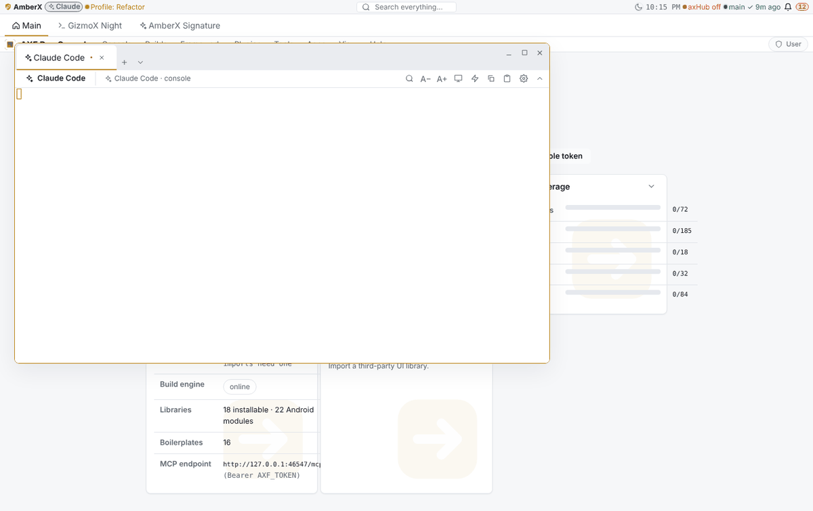 |
| Terminal, phone | 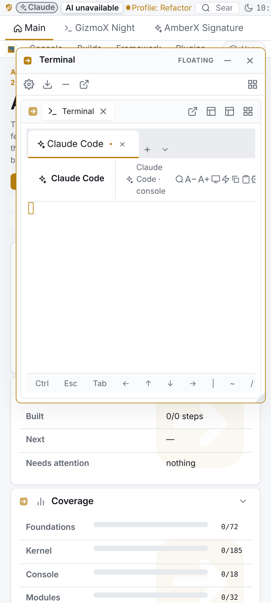 | 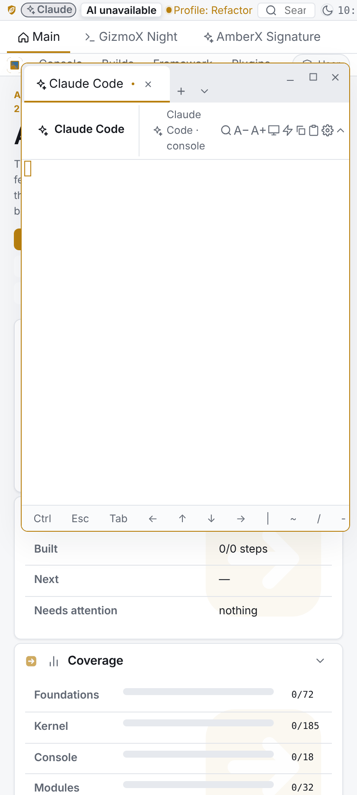 |
| Maximize (before: no button, window as opened) | 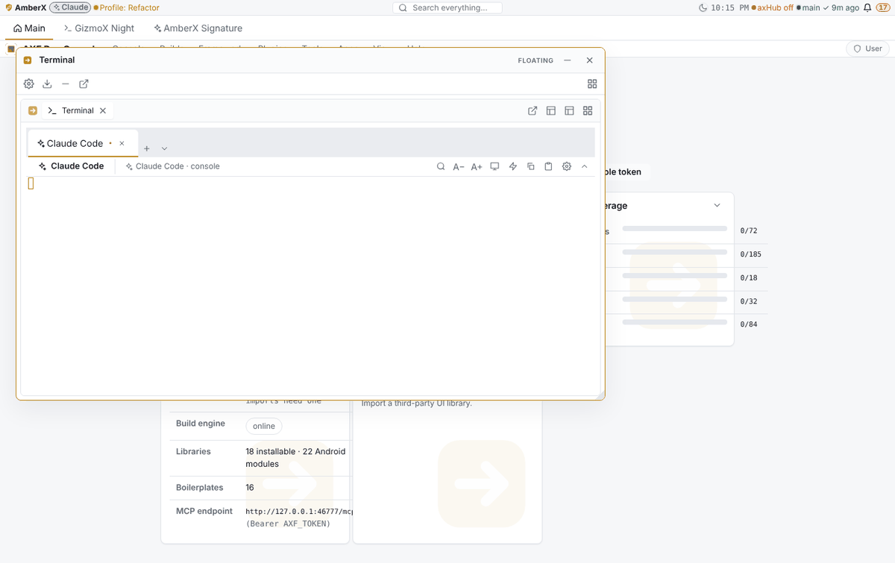 | 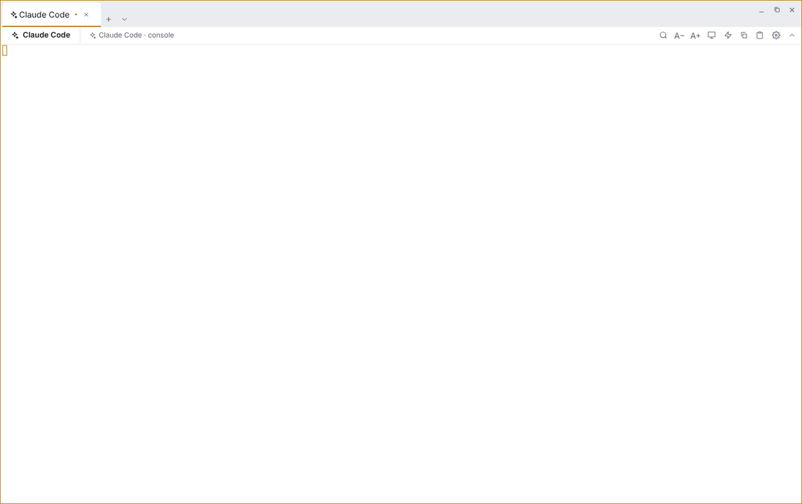 |
| Drag to the left edge (after: LEFT snap preview) | 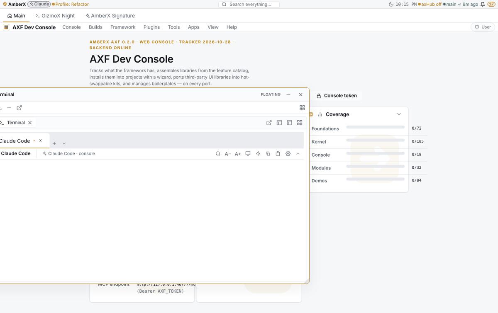 | 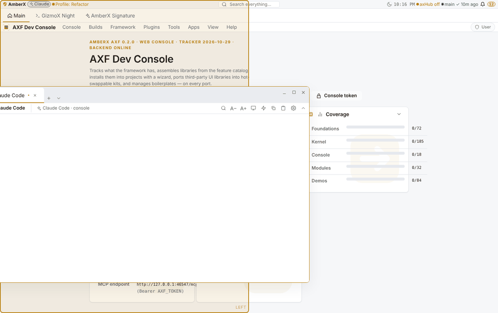 |
| Settings page, level toolbar | 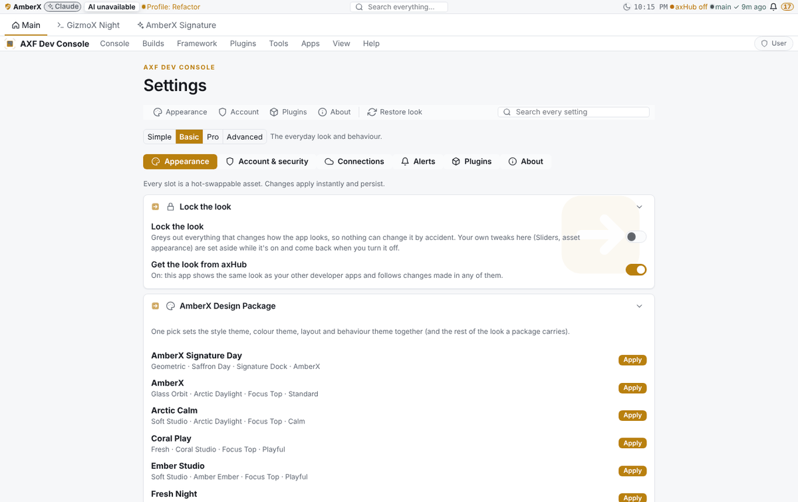 | 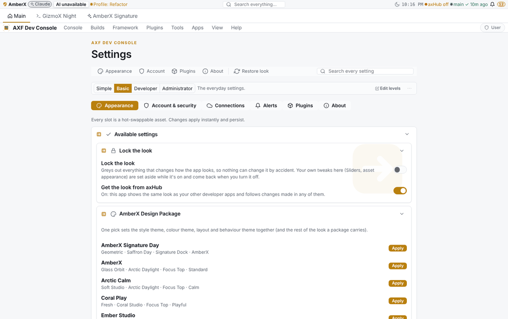 |
| Settings, phone | 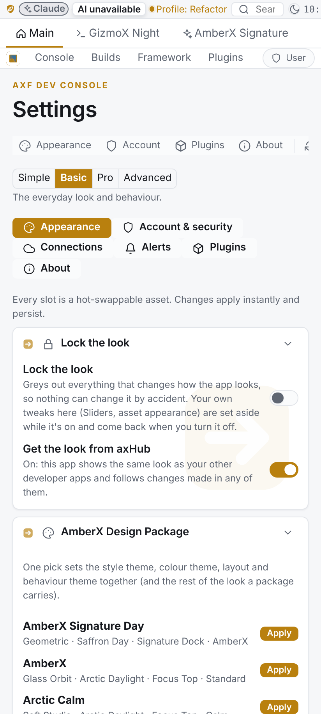 | 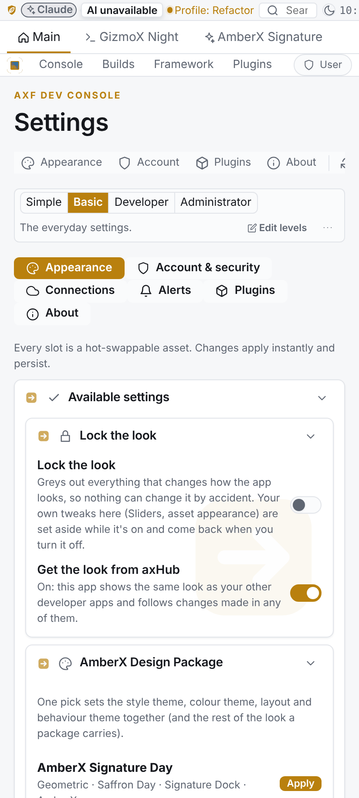 |

After only: [level editor dialog](windows-terminal-fable/shots/after/level-editor-desktop.png) ·
[level editor on a phone](windows-terminal-fable/shots/after/level-editor-phone.png) ·
[maximized on a phone](windows-terminal-fable/shots/after/terminal-maximized-phone.png).

## Known gaps

- **Android twins deferred** (`framework/spec/PORTING.md`): `contract/Windows.kt` fields + functions and the
  `windows.json` replay, the Compose window host's 8 handle hit areas, caption buttons, frameless slot and snap preview
  layer; Kotlin `SettingsUiEngine` levels + visible sets, lib-settings level toolbar and level editor replaying
  `settings-ui.json`. Android work is on hold (rule), Brett finishes that side.
- Snap zones are the Windows set (halves, quarters, top = maximize); no user-defined zone layouts yet (`SnapRules` is the
  seam).
- The Terminal's caption buttons live in the plugin; other frameless content has to wire `useWindowFrame()` itself.
- `rebake.mjs status` reported every app as "edited" before this step because CI re-bakes without rewriting
  `axf.lock.json`; the locks are rewritten now, but a CI bake will drift them again until CI calls `rebake.mjs apply`.
- No Android screenshots: the rebuild branch is not named `fable/` / `rebuild/`, so `rebuild-shots.yml` did not run, and
  no Android code changed.
