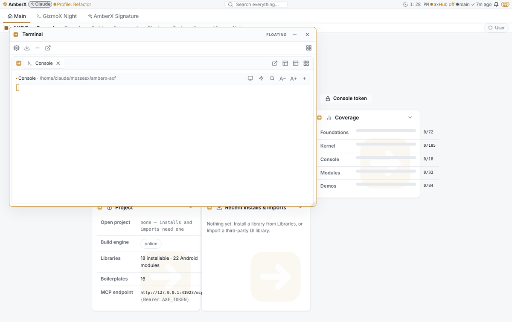
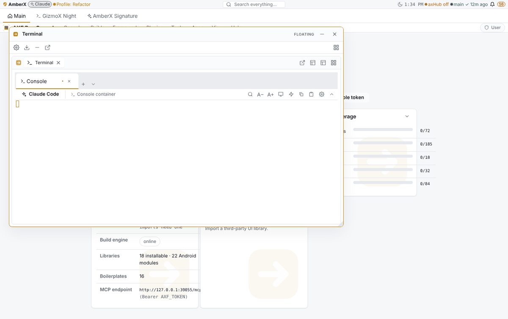
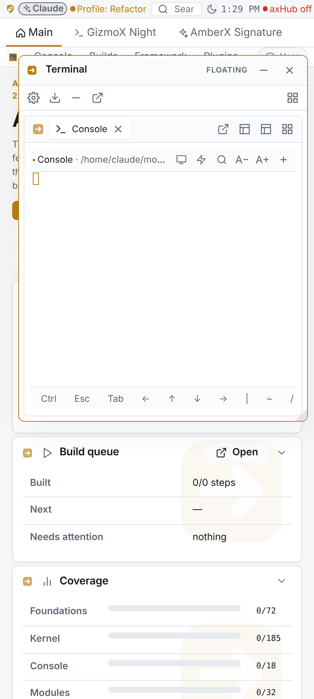
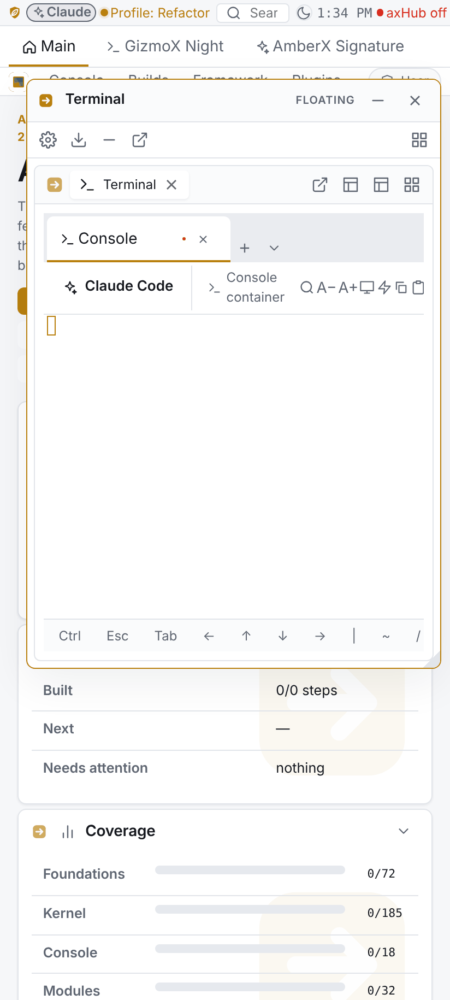
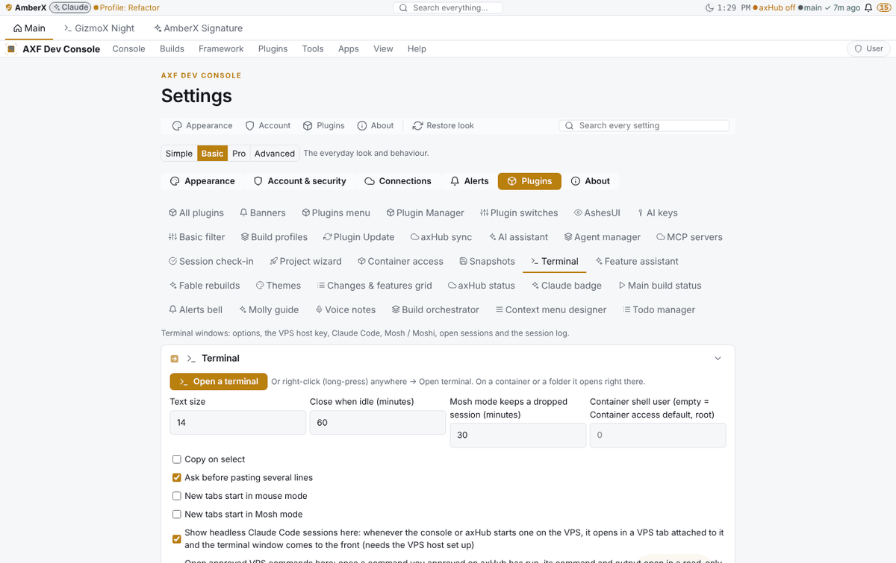
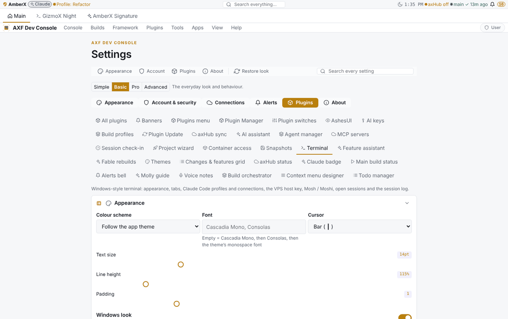

# windows-terminal — Opus phase (Terminal plugin v0.2.0 → v0.3.0)

Orchestrator build `windows-terminal` (Refactor profile), steps s1–s5, Opus, branch `claude/windows-terminal`.
Asked by Brett (Oct 28 2026, claude.ai): a powerful terminal that looks, feels and behaves like a Windows program;
a toolbar button that adds a Claude Code tab and asks for a connection; right-click any tab to manage its connection
(VPS root, specific containers, axHub…); Claude Code profiles; powerful, easy settings. Opens floating by default.
The Fable phase (s6–s12: window resize from every edge, snapping, frameless windows, settings levels toolbar + level
editor) follows on its own branch after the model-switch approval.

## Differences

**Removed**
- `web/TerminalTab.tsx` (one window-engine tab per shell, with its own bar). Its screen code lives on in `TerminalSession.tsx`.
- The per-tab bar (title, mouse/Mosh/search/size/+ buttons) — replaced by the host's tab strip + command toolbar.

**Kept**
- Every session feature: mouse mode, Mosh mode (server-kept, reconnect, predictive echo), search, copy/paste and the
  multi-line paste warning, the phone key row, the terminal right-click menu, idle timeout, the session log, one-time
  WebSocket tickets, clean shell environment, protected-container confirm, headless Claude Code tabs, approved-command
  output tabs, Open terminal on every right-click. Server API unchanged except the additions below.

**Changed**
- One window = one **terminal host** (`terminal-host` tab, `TerminalHost.tsx`) with its own Windows Terminal tab strip;
  sessions are kept in `hosts.ts` (per browser) instead of being window-engine tabs. Legacy `terminal` tabs open as a host
  with one session. `newTab()` returns a session id; `bringToFront()` takes a session id.
- Font: Cascadia Mono → Cascadia Code → Consolas → the theme's monospace font (was the theme's only).
- New terminal follows Settings → Startup (Claude Code on the default profile by default).
- Menus portal to `<body>` and sit above every window (a blurred window traps fixed children).

**Added**
- Tab strip: icon, title, status dot, badge, close; double-click rename, middle-click close, drag to reorder; right-click:
  Connection…, Rename, Duplicate, tab colour, Move to a new window, Close / Close others / Close to the right.
- **+** (like the current tab, or the picker) and **∨** (Claude Code…, every profile, Shell…, console, VPS, containers, Settings).
- Command toolbar (hideable): Claude Code, the tab's connection, find, A−/A+, mouse, Mosh, copy, paste, settings.
- Windows keys: Ctrl+Shift+T/W/D, Ctrl+Tab / Ctrl+Shift+Tab, Ctrl+Alt+1…9, Ctrl+= / Ctrl+-.
- Close confirm for a running tab; closing the last tab closes the window.
- **Connections**: `GET connections`; Claude Code `via` console / vps / container / axhub (`--mcp-config` with axHub's
  MCP URL, `AXF_AXHUB_MCP_URL` overrides); connection picker dialog `terminal.connect`; per-tab Connection manager
  dialog `terminal.connection` (facts, Reconnect, Switch connection, New tab elsewhere). Docker down → the other
  connections still list, with a note.
- **Claude Code profiles** (`claudeProfiles`, `defaultClaudeProfile`): model, permission mode, flags, folder, first
  prompt, icon, colour, default connection; server-checked (`clean_profile`, `claude_args`).
- **Settings** (live, `look.tsx`): colour scheme (6 Windows Terminal schemes in `schemes.json` or the app theme), font,
  cursor style + blink, text size, line height, padding, Windows look, Mica, toolbar, startup, + button, tab width, bell
  (flash / sound / off), scrollback, close confirm, copy on select, paste warning. Each carries `data-axf-level`.
- `framework/cli/rebuild-shots.mjs` prints page errors (found a render loop here before it shipped).

## Contracts, data, migrations
- Settings file `terminal-settings@1` gains the keys above (defaults fill old files; nothing to migrate).
- `Open` gains `via`, `profile`, `model`, `permissionMode`, `flags`, `prompt`.
- No asset types, engines or fixtures changed (the window engine work is the Fable phase).

## Tests
- `test.py`: 28 → 47 checks (claude args + refusals, connections list, via checks, profiles + look settings saves and refusals).
- `tsc --noEmit` clean; `vite build` ok; `plugin-lifecycle check` clean; `check-theme` conformant.

## Known gaps (→ Fable phase / later)
- The window engine still draws its own title bar, window toolbar and tab-group bar above the host's strip: the
  frameless window with the tab strip in the title bar is s6 (window engine). Minimize / maximize / snap / edge resize
  come from s6–s8.
- Tab drag between windows: use *Move to a new window* for now.
- In this sandbox the shells don't connect (no WebSocket through the shot harness, same before and after).

## Screenshots
Before (v0.2.0) and after, desktop + phone, `AXF_APPEARANCE_HUB=off`:

| | Before | After |
|---|---|---|
| Window |  |  |
| Phone |  |  |
| Settings |  |  |

After only: [connection picker](windows-terminal/shots/after/terminal-picker-desktop.png) ·
[∨ new-tab menu](windows-terminal/shots/after/terminal-newtab-menu-desktop.png) ·
[tab menu](windows-terminal/shots/after/terminal-tab-menu-desktop.png) ·
[picker on a phone](windows-terminal/shots/after/terminal-picker-phone.png)
