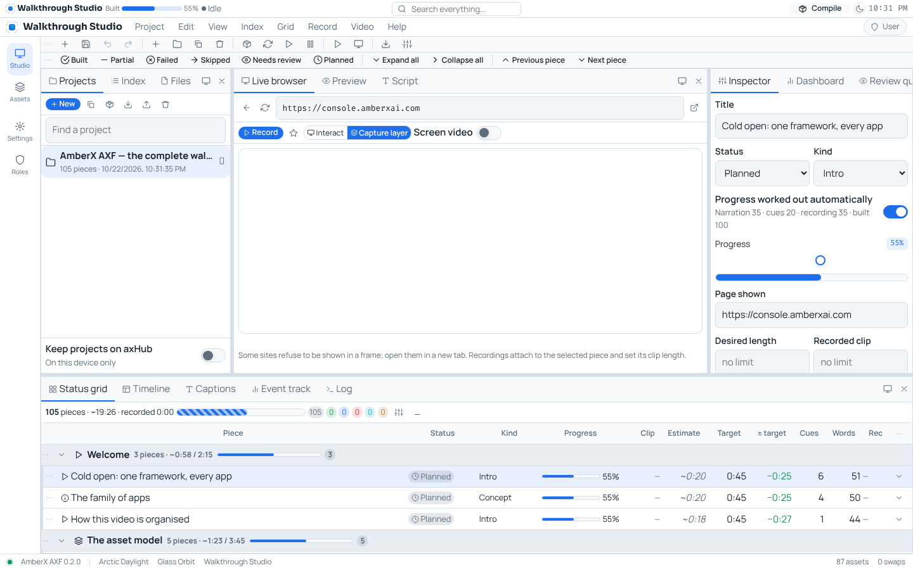
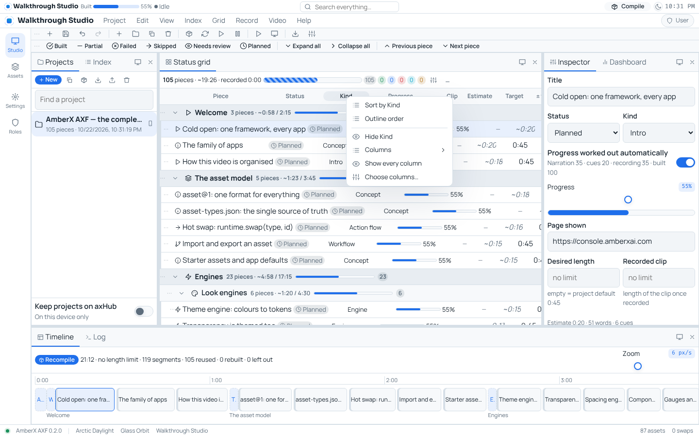
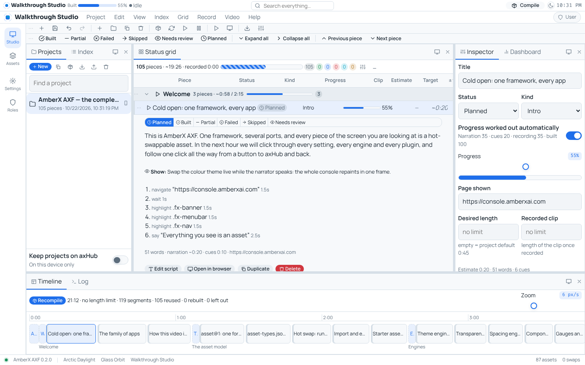
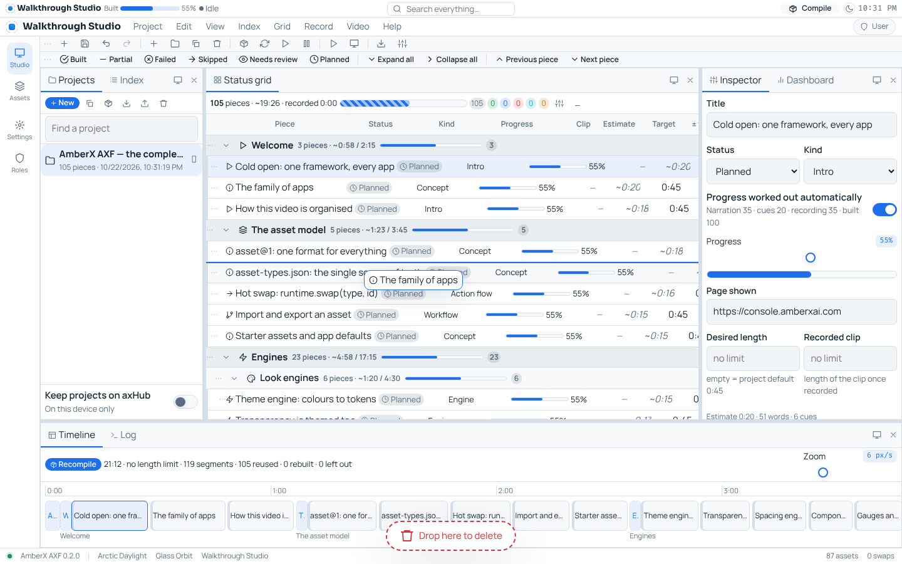
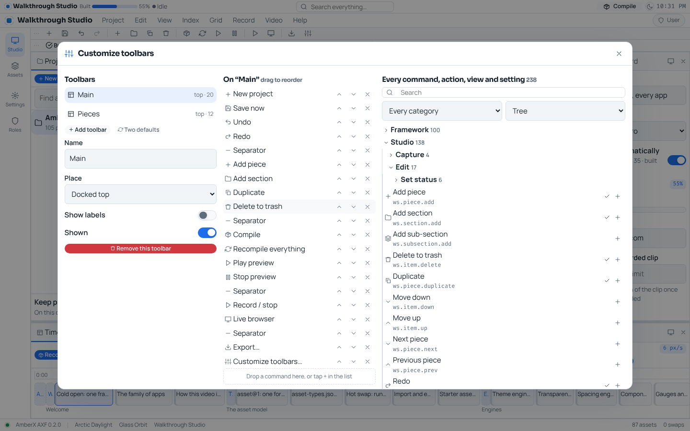
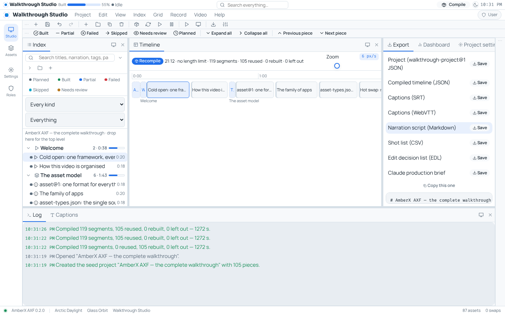
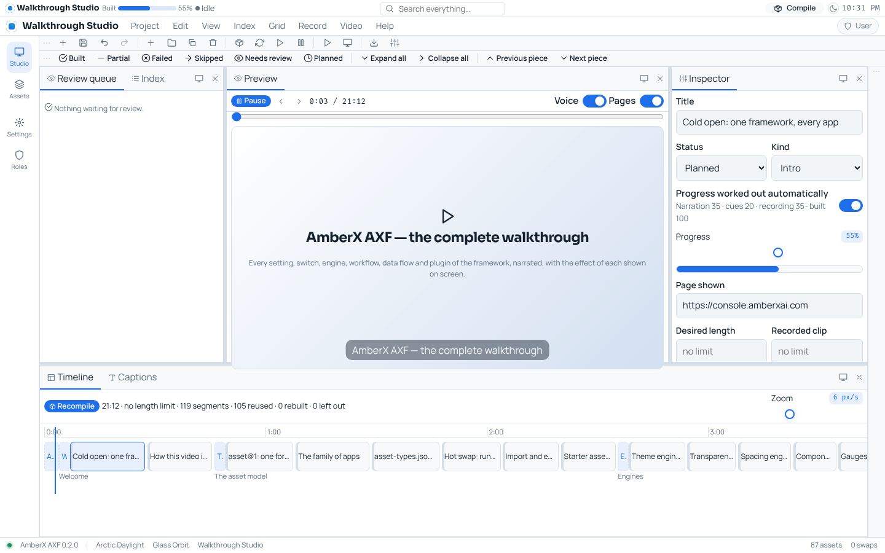
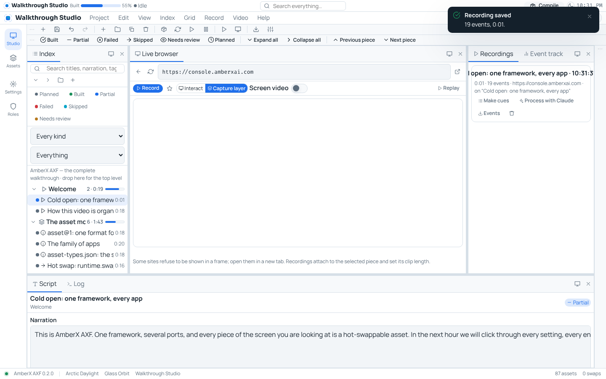
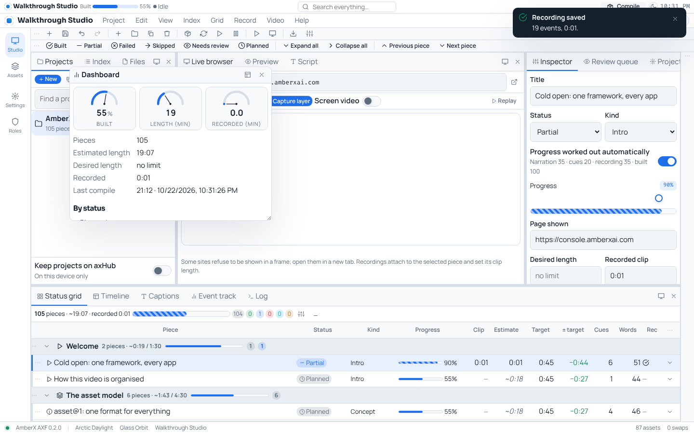
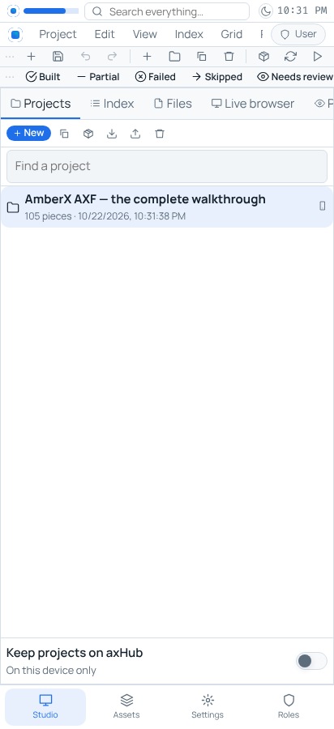

# Walkthrough Studio (Oct 22 2026, Opus)

`apps/walkthrough-studio` — a video walkthrough assembly suite built on AXF (react-ts, **developer app**: look + settings
from axHub's appearance document; `VITE_AXF_HUB=off` for local work). Plan only for now: it plans, records and compiles a
narrated walkthrough; the final render is later (the compiler's Claude brief / EDL / captions are the hand-off).

## What it does
- **Projects column**: many projects (`walkthrough-project@1`); pick one and the whole studio renders it. New (blank or the
  framework walkthrough seed), duplicate, rename, compile, export, import, delete from its toolbar or right-click.
- **Seed project** "AmberX AXF — the complete walkthrough": 105 narrated pieces in 15 chapters (asset model, every engine,
  every settings tab, Dev Console views, every console plugin, "follow one click" from button → plugin server → axHub
  approval → back, data on axHub, vault/credentials/subscriptions, MCP, GitHub automation, Coolify, Hostinger, Moshi).
  Each piece: narration, cue track (open page, move, click, type, key, scroll, highlight, wait, caption), page, the effect
  to show. Extend it in the studio; the seed lives in `src/studio/seed.ts`.
- **Index**: categorized multi-level tree, search (titles, narration, tags, pages), filters (status, kind, recorded / not /
  no narration / over target), drag-and-drop (before / after / into a section).
- **Status grid**: a sub-grid per category and sub-category with totals + progress meter; rows: status, kind, progress bar,
  clip length, estimate (while not recorded), target, ± target, cues, words, rec, tags, page, notes, updated. Rows expand
  (quick status, narration, effect, cues, actions). Every column but the title hides (header right-click, View › Grid
  columns, Grid menu, chooser dialog); headers sort. Rows/sections drag to arrange or onto the **trash can that pops up at
  the bottom while dragging** (to the project trash, restorable; undo too).
- **Workspace**: 18 panes (Projects, Index, Status grid, Inspector, Script, Review queue, Live browser, Recordings, Event
  track, Files, Preview, Timeline, Captions, Export, Dashboard, Project settings, Trash, Log) in 4 areas with tabs +
  splitters, or floating windows; 7 layouts (IDE, Grid, Record, Write, Review, Compile, Focus); show/hide/move/float any
  pane anytime (tab drag, pane menu, context menu, View menu, toolbar); maximise an area; phone = one tabbed area.
- **Toolbars**: two by default (Main, Pieces); add any number; dock top/bottom/left/right or float (drag the grip; drop
  near an edge to dock); drag items to reorder or onto the trash can; **Customize toolbars** dialog: every command, pane,
  layout, grid column, status, export, framework action, view, settings tab and asset swap (238) in a categorized,
  sortable (tree / A→Z / Z→A), filterable, searchable tree; drag or + to add.
- **Live browser + recorder**: open any page in a frame; Record in *Capture layer* mode (records every move/click/scroll/
  key over the frame) or *Interact* (records the frame's own events when same-site); optional screen video
  (getDisplayMedia → IndexedDB, device only); markers; replay as an animated cursor. A recording attaches to the selected
  piece (clip length, status partial). **Make cues** turns events into a cue track; **Process with Claude** builds the
  prompt (piece, narration, events), you paste Claude's JSON back and it fills narration + cues (status Needs review).
  No API key is held by the app.
- **Compiler** (`walkthrough-timeline@1`): title + chapter cards, pieces end to end with a gap, narration split into timed
  caption lines at the project's wpm/rate, cues spread across the narration; per-piece hash → a recompile reuses
  unchanged segments (swapping pieces = 0 rebuilt). Warnings: over target, no narration, failed included. Exports:
  project JSON, timeline JSON, SRT, VTT, narration script (Markdown), shot list (CSV), EDL, Claude production brief.
- **Preview**: plays the compiled video — browser voice (speechSynthesis) reads each line, captions, transitions, cursor
  acting the cues over the page. **Timeline** to scale with target line, playhead, chapters; drag blocks to swap.
- **Project settings**: desired length (no limit when empty), desired piece length, gap, voice/speed/rate/pitch, resolution
  (incl. 1080×1920 phone), fps, transition, cursor, captions, chapter cards, ripples, which statuses are left out.
- **Storage**: this device always; **Keep projects on axHub** also saves to the hub's data server
  (`/data/walkthrough-studio/index.json`, `projects/<id>/head.json` + `pieces-<n>.json`, each < 64 KB, If-Match). Needs
  the studio's origin in `AXHUB_DATA_ORIGINS` once it's deployed (not deployed yet).
- Banner: built %, recording status, review count, search, Compile, day/night, clock. App menu: Project, Edit, View,
  Index, Grid, Record, Video, Help (check marks bound to runtime counters). Settings → Plugins → Walkthrough Studio.

## Tests
`npx -y tsx apps/walkthrough-studio/test.mts` (38: seed coverage, moves, trash/restore, incremental compile, exports,
round trip) + typecheck/build in CI (`android.yml`). Checked with `check-theme.mjs` and `check-controls.mjs`.

## Not yet
- Rendering a real video file (the plan + captions + EDL + brief are the hand-off; a renderer is a later build).
- Deploy (Coolify app + DNS + `AXHUB_DATA_ORIGINS`).
- Fable rebuild parked: `walkthrough-studio-fable` (dockable/floating toolbars + pane workspace as a framework engine).

## Screenshots
 
 
 
 
 

