# UI Review (console plugin, Angel build `ui-review`, Oct 30 2026)

Brett, Oct 30 2026 (voice, driving): rename the Design packs plugin and make it one all-in-one UI approval plugin.
Every UI a build makes goes there for his approval, separated by type, with design packs as one section.

## What it is

- **Folder** `ui-review` (id `ai.amberx.axf.console.ui-review`, replaces `ai.amberx.axf.console.design-packs`).
  View → **UI Review**; View → **Design packs** opens the same page on its Design packs section.
- **Sections** = kinds, an open registry: the plugin's `kinds.json` (Design packs, Whole apps / programs, Screens &
  pages, Settings interfaces, Dialogs & popups, Menus & toolbars, Banners & cards, Other), plus `kinds.json` in its
  data folder, plus any kind an item names (shown with a label made from its id). No code change for a new kind.
- **Item** (`review-item@1`): title, kind, app, build, branch, PR, screenshots (`device` phone / desktop, from the
  file name), notes, status (waiting / changes asked / rejected / approved), his comment, history (who, when,
  what, comment). Unknown fields are kept.
- **Views** (remembered in settings): Grid (collapsible rows, a row opens to the screenshot browser + details +
  decisions), Tree (kind › app › item, tri-state checkboxes), Sub-grids (group by kind, app, status or build),
  Gallery (large shots, a card opens full width), Compare (selected items side by side, one screen index for all).
  Every view has checkboxes; the bulk bar (Approve / Ask changes / Reject + comment) sticks to the bottom.
  Search, status, app, phone/desktop shots, order (waiting first by default), counts per section (waiting/total).
- **Design packs**: the 18 packs (3 rounds, 12 shots each) in the plugin's `packs/`; Pick (max 3) stays; picks
  moved from the old data folder (`.axf-console/plugins/design-packs/picks.json`) into the new one on first start
  (server import and `install.mjs` both migrate, then delete the old folder and its console-state entry). A pack can
  also be approved / rejected like any item (decisions are saved as an overlay `pack:<id>`).

## How builds submit

```bash
node apps/console-web/plugins/ui-review/review.mjs submit --kind settings --title "Level bar" \
  --shots a-phone.png,a-desktop.png --app Console --branch claude/x --pr 180 --console
node framework/cli/rebuild-shots.mjs --repo . --out shots --shots shots.json --submit screen --title "…" --pr 180 --console
curl -H "Authorization: Bearer $AXF_TOKEN" -d '{"kind":"screen","title":"…","files":[{"name":"x-phone.png","data":"<base64>"}]}' \
  https://console.amberxai.com/api/plugins/ui-review/submit
```

`--console` posts to the running console (`AXF_CONSOLE_URL` + `AXF_TOKEN`), so Brett sees it at once; without it the
CLI writes this checkout's data folder (`AXF_UI_REVIEW_DIR` overrides). `rebuild-shots --submit` finds the submitter
by capability (`service:ui-review@1` + `review.mjs`), never by folder name.

## Screenshots tab (`ui-screenshot@1`, Nov 1 2026)

Brett: UI Review only showed planned build screens waiting for a decision; there was no place for ad-hoc pictures.
The **Screenshots** tab (View → Screenshots, or the tab strip under the page title) holds them. They **never enter
the approve / reject queue** (separate store, never counted by `ui-review@1` state) unless he taps **Send to review**,
which copies the picture into a normal waiting item (the screenshot stays and remembers the item).

- **Record**: id, title, source (`check`, `build`, `pr`, `manual`, `watch-live`), session, build, agent, app,
  screen/route, viewport (phone / desktop, from `--viewport` or the file name), takenAt, addedAt, before/after `pair`
  + `side`, note, branch, PR, by, promoted (review item ids). Unknown fields kept. Pure core `web/shots-core.mjs`
  (= `server/screenshots.py`).
- **Files**: `<data folder>/screenshots/index.json` + `screenshots/files/<id>.<ext>` (the console data volume).
- **Intake** (console token or a signed-in admin, like every plugin route):
  `node framework/cli/shot.mjs <file>… --title "…" --app Breakroom --screen /breakroom --source check --session <id>
  [--viewport phone] [--pair <id> --side before|after] [--note …] [--pr N]` (also `axf shot …`; posts to the console
  when `AXF_CONSOLE_URL` + `AXF_TOKEN` are set, else writes this checkout; `list`, `promote <id>`, `migrate`, `paths`),
  `POST /api/plugins/ui-review/shots` (JSON with `data` base64 / data URL or `files: [...]`, or multipart
  `curl -F file=@x.png -F title=… -F app=…`), and the tab's **Upload** button (camera roll on a phone).
  A pair with no side: the first is *before*, the next *after*.
- **Routes**: `GET shots`, `POST shots`, `GET shots/file?id=`, `POST shots/update`, `shots/remove`, `shots/promote`,
  `shots/migrate`.
- **Page**: framework DataGrid (search, app / source / device filters, sortable columns incl. the *Taken* date,
  column menu) grouped by app, screen, source or day (or none), or a thumbnails layout; tap → full-screen viewer
  (swipe, ← →, Esc), before/after slider when paired, Copy link (`?ui-shot=<id>` opens it), Send to review, Delete.
- **Migration**: review items titled `Breakroom check: …` (a check session that used the review queue) move into
  Screenshots on start and with `POST shots/migrate` / `shot.mjs migrate` (one screenshot per picture, source
  `check`, the item and its folder removed; note in `screenshots/migrated.json`; idempotent).
- **Rule** (shared RULES, build briefs): non-review screenshots use `axf shot`, never `review.mjs submit`.

### Groups (`shot-group@1`, Nov 1 2026)

Brett: Screenshots fills up fast, so every screenshot belongs to **exactly one named, timestamped group**, and Claude
asks him for the name before sending (shared rule *Screenshots go in a named group*; headless sessions name it after
their build).

- **Group**: id (`g-<date>-<hex>`), name, createdAt, source, session, build, agent, app, note. Kept in the same
  `screenshots/index.json` (`groups: [...]`); each screenshot carries `group` (an id). Pure core `web/groups-core.mjs`
  (= the group helpers in `server/screenshots.py`).
- **Intake**: `--group "<name>"` (CLI) / `group` (API) picks the group of that name made **the same day** (case and
  spaces ignored), else makes it; `--group-id` / `groupId` = an existing group. One upload = one group. No name =
  `<session/build/source> - <YYYY-MM-DD HH:mm>`. Days and times are in the console's zone (`AXF_SHOT_TZ`, default
  America/New_York; a rule-based Eastern fallback when the image has no tzdata).
- **Routes**: `GET shots` (also `groups`), `POST shots/groups` (make / reuse), `shots/groups/update` (rename),
  `shots/groups/merge {from, into}`, `shots/groups/delete {id, into?}` (with `into` the shots move; without, they are
  deleted), `shots/move {ids, group | groupName}`. `shots/update` never changes a group.
- **CLI**: `shot groups [--q …]`, `shot group new|rename|merge|delete`, `shot move <ids> <group id | name>`, `shot list --group <id>`.
- **Page**: the group list comes first (newest first; cover thumbnail, name, apps, time, count, source; grid or
  thumbnails), searched by name, date (`Oct 31`, `2026-10-31`), app or source. Tap a group for its shots (the old grid /
  thumbnails, filters and viewer), with **Rename**, **Merge** (into another group), **Select** (tap shots, then *Move
  to* a group or a new one) and **Delete** (with its shots). Upload asks for the group name first (default
  `Upload - <Mon D h:mm PM>`); inside a group it uploads there.
- **Migration**: screenshots from before groups are put in `'<title prefix> - <YYYY-MM-DD HH:mm of their first shot>'`
  groups on the next read (so the Breakroom check pictures become `Breakroom check - 2026-10-31 20:20`), one group per
  prefix and day; the Breakroom item migration does the same right after moving them. Idempotent.

## State for other plugins (`ui-review@1`)

`plugin_services.get("ui-review@1")` → `state(branch, pr)`, `holds(branch, pr)`, `items(branch, pr)`, `submit(fields,
shots)`. HTTP: `GET /api/plugins/ui-review/state?branch=&pr=`. CLI: `review.mjs state --pr N --exit-code` (exit 3 =
held). The state is the strictest of the branch's / PR's items: rejected > changes > waiting > approved; `none`
when nothing was submitted. `holds` is true for waiting, changes and rejected.

**Follow-up (not built here):** the push banner's batch merge should hold PRs whose `ui-review@1` state holds. The
push-banner plugin is being changed by another build, so it was not touched; orchestrator `ui-review` step s9.

## Checks

`python apps/console-web/plugins/ui-review/test.py` (89 checks: migration, kinds, submit, shots, decide, bulk, packs,
remove, picks, state, capability; Screenshots: intake JSON + multipart, auth through the real console, never in the
queue, promote, Breakroom migration, delete; groups: create / reuse / auto name / next day, rename, merge, move, delete
with and without into, repair of ungrouped shots) · `node --experimental-strip-types apps/console-web/plugins/ui-review/test.mts`
(20 groups: core, packs, CLI end to end, rebuild-shots option, screenshots core, migration, shot CLI, groups core
(create / reuse, rows + search, rename / merge / move, migration), shot CLI groups, capability) · console `tsc` + `vite build` · `check-theme`,
`check-controls`, `check-plugin-pages`, `plugin-lifecycle check ui-review`, `menu-reach`: all pass.

## Screenshots (demo data: 9 submitted items + the 18 packs)

| View | Phone | Desktop |
|---|---|---|
| Grid, a row open | 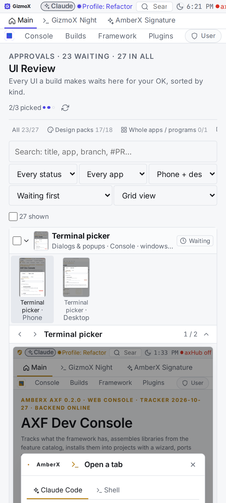 | 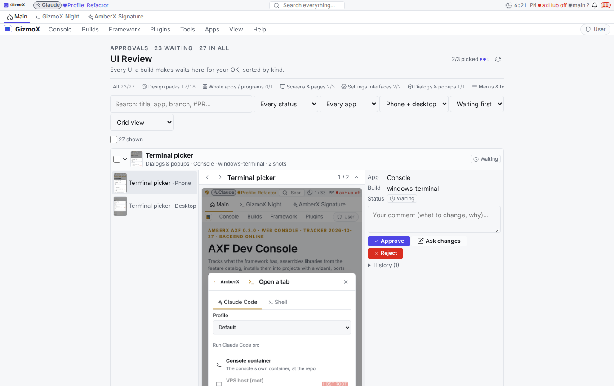 |
| Tree, two ticked (bulk bar) | 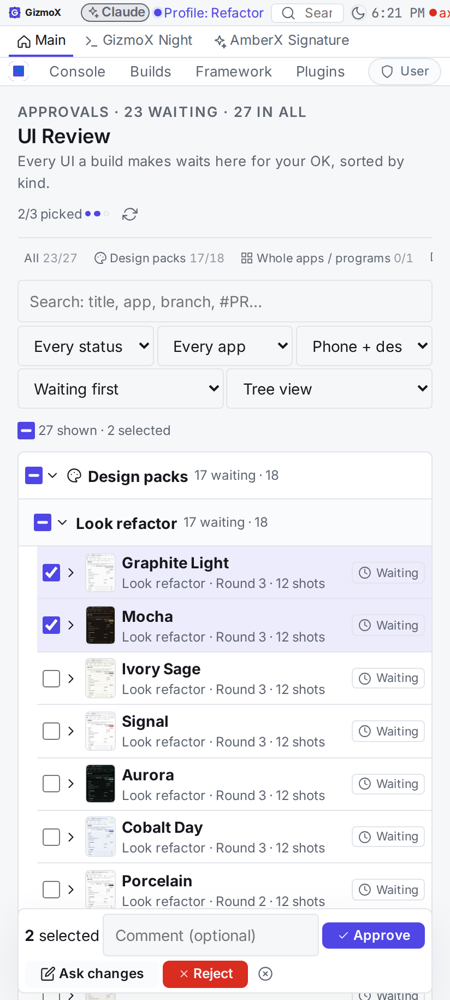 | 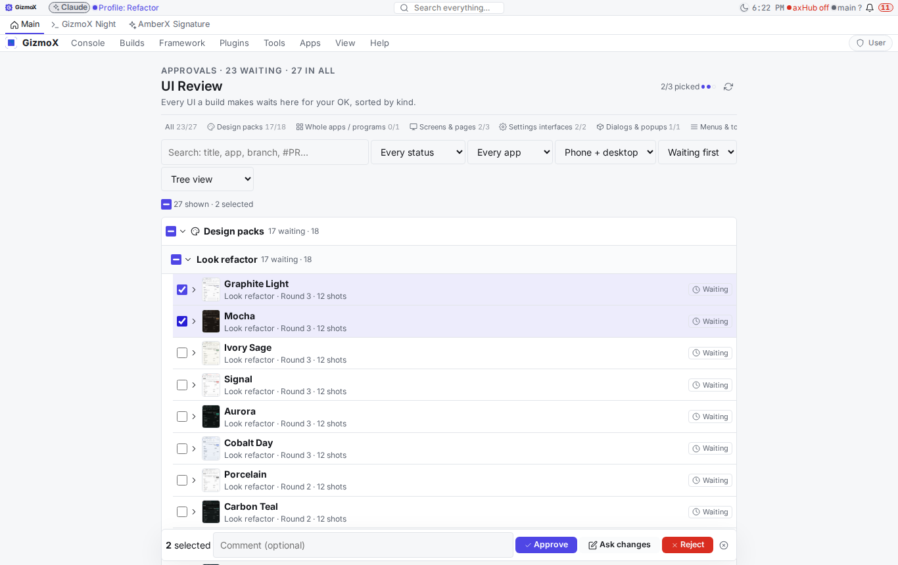 |
| Sub-grids by kind | 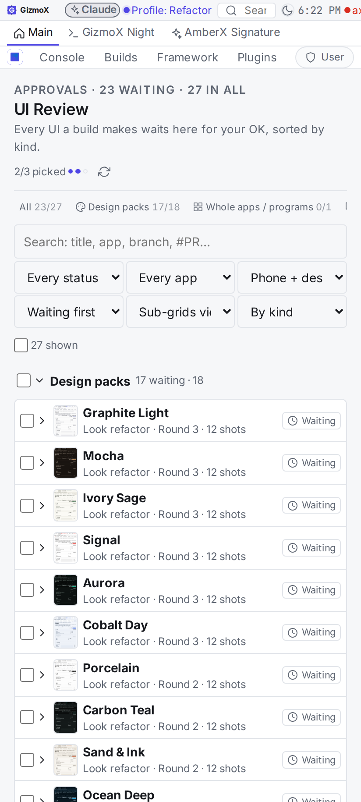 | 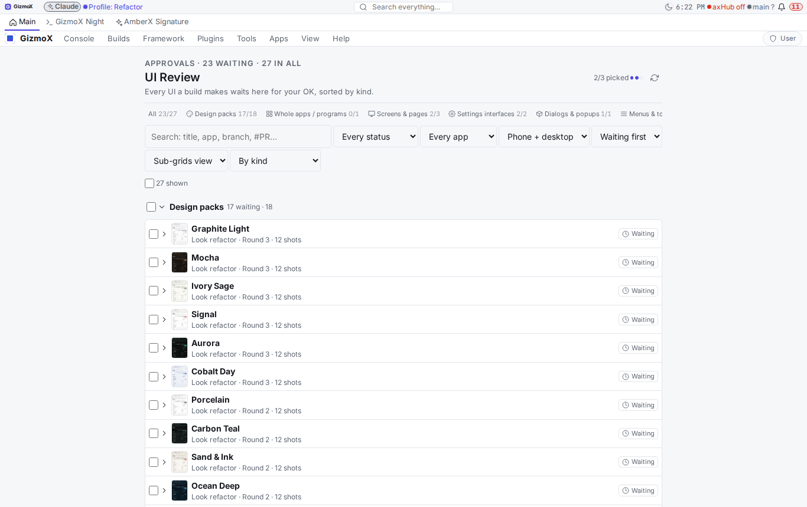 |
| Gallery | 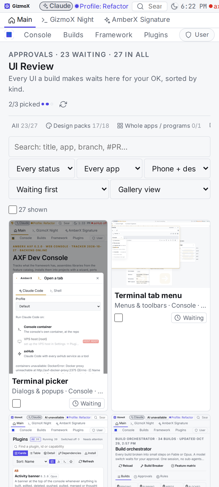 | 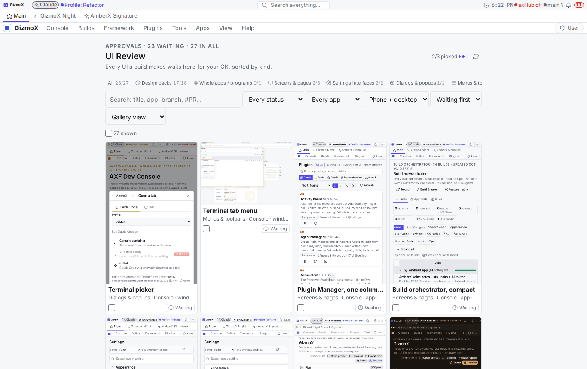 |
| Compare | 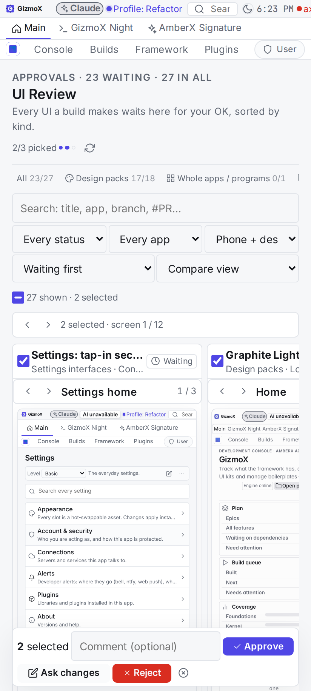 | 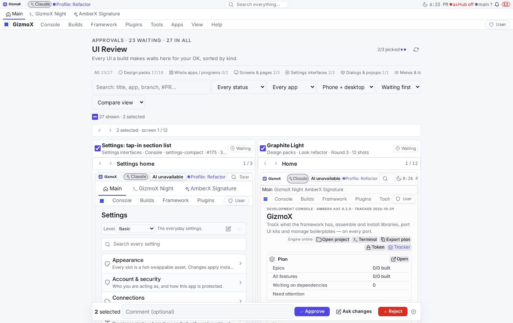 |
| View → Design packs | 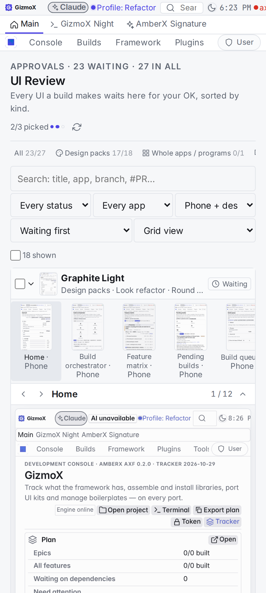 | 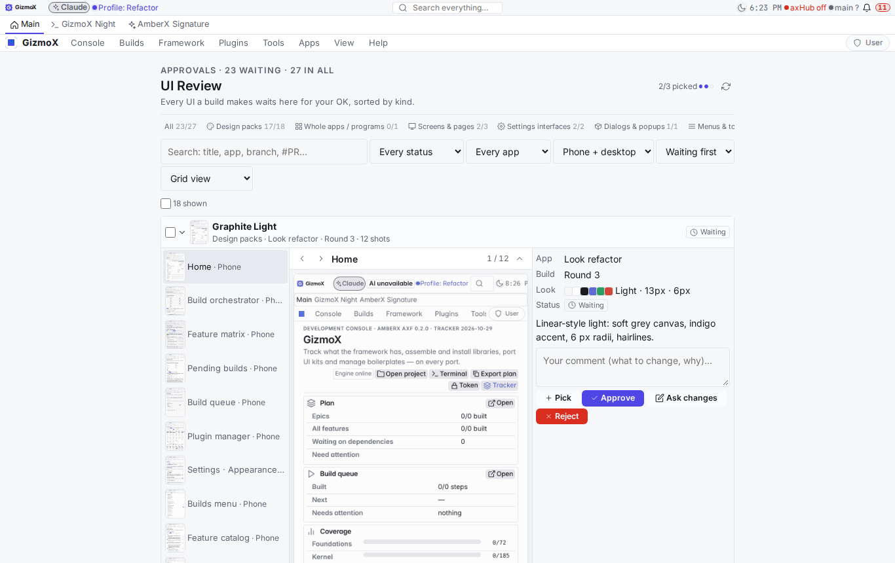 |

Captured with `AXF_APPEARANCE_HUB=off AXF_UI_REVIEW_DIR=<demo> node framework/cli/rebuild-shots.mjs --shots
_claude/memory/docs/ui-review/shots/shots.json …` (views switched with `AXF.navigate` + the View dropdown).
